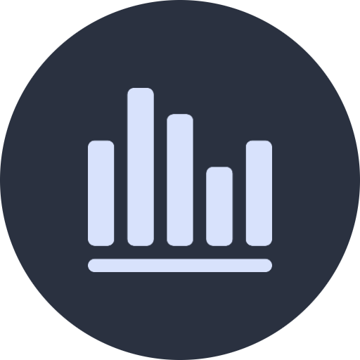
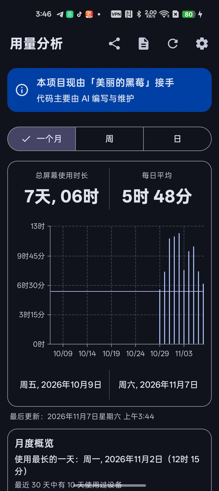
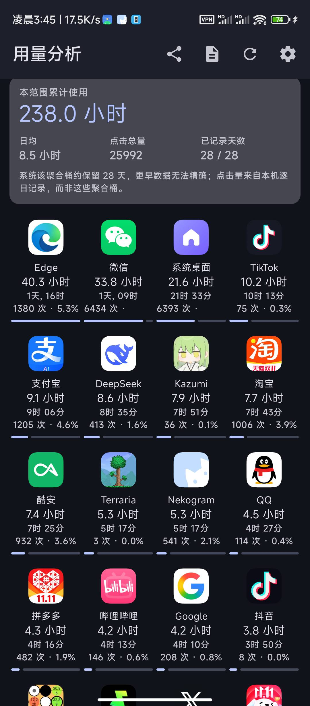
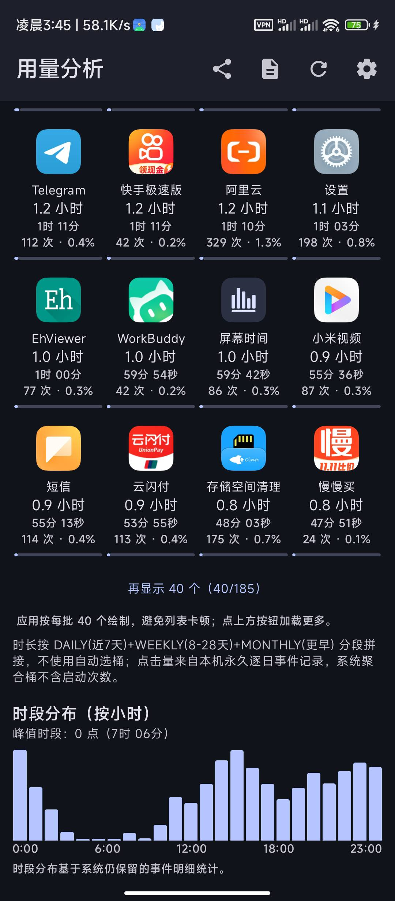
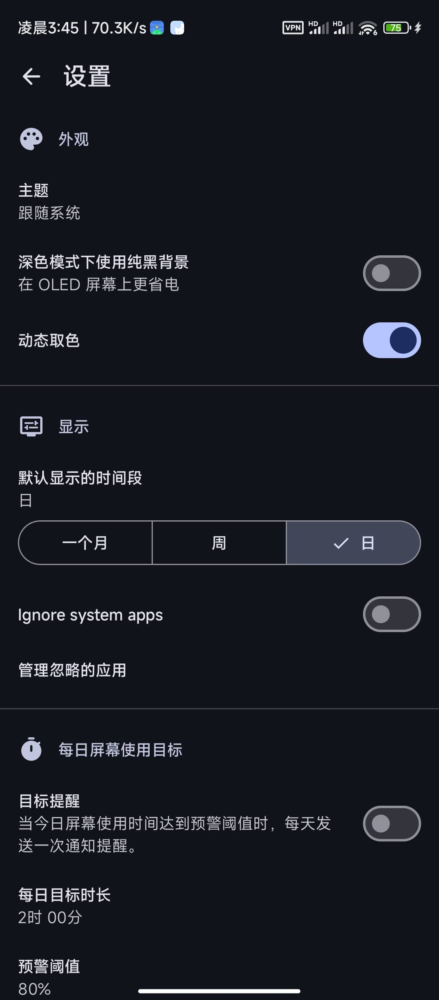
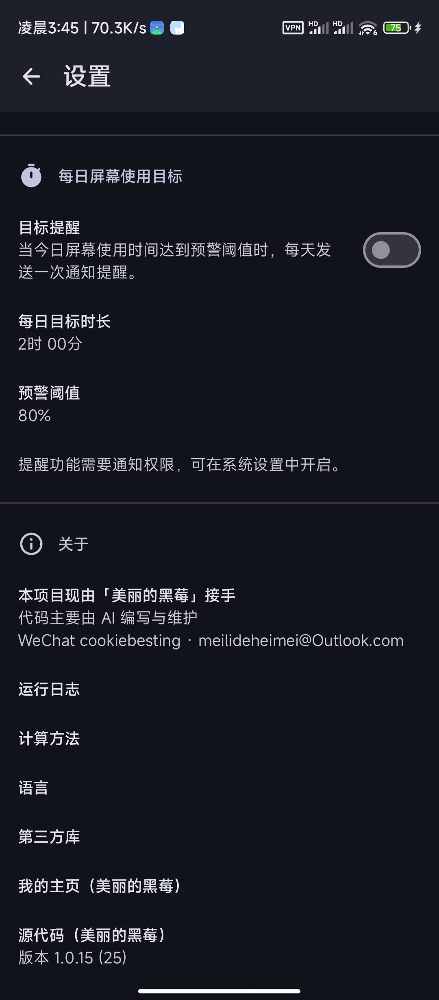

<div align="center"></div>

# <div align="center">Screen Time · 屏幕使用时间</div>

<div align="center">

一款查看设备与应用使用时长、点击量和长期趋势的 Android 应用

**由 美丽的黑莓 接手并主导维护 · 代码主要由 AI 辅助编写**

</div>

<div align="center">

[](https://github.com/annbnn183/MyScreenTime/releases)
[](https://www.android.com)
[](https://kotlinlang.org)
[](https://www.gnu.org/licenses/gpl-3.0)
[](.github/workflows/build.yml)

</div>

<div align="center">

[English](README_en.md) · [日本語](README_ja.md) · [한국어](README_ko.md) · [繁體中文](README_zh-TW.md)

</div>

---

## 📑 目录

- [关于这个项目](#关于这个项目)
- [✨ 功能特性](#-功能特性)
- [💾 数据管理：备份、恢复与迁移](#-数据管理备份恢复与迁移)
- [⚡ v1.0.17 → v1.0.18：体验优化](#-v1017--v1018依据真实运行日志的体验优化)
- [📸 界面截图](#-界面截图)
- [⬇️ 下载](#️-下载)
- [💬 联系我](#-联系我)
- [☕ 打赏 / 支持我](#-打赏--支持我)
- [🧭 产品战略与发展路线](#-产品战略与发展路线)
- [⚙️ 自动构建](#️-自动构建)
- [🔐 校验和](#-校验和)
- [📄 许可证](#-许可证)

---

## 关于这个项目

这个项目现在由我（**美丽的黑莓**）接手。从功能规划、交互取舍到每个版本的发布，都由我推进；具体代码主要借助 AI 编写与迭代。应用内的主界面和「设置 → 关于」里也放了同样的说明。

在原开源项目的基础上，我陆续补上了这些能力，并坚持一条原则：**开源、无广告、不联网、不采集数据**。界面为 Material 3，使用 Kotlin + Jetpack Compose + Vico 开发。

---

## ✨ 功能特性

| 🗓️ 多周期与长期趋势 | 📊 应用四列网格排行 |
| :--- | :--- |
| 日 / 周 / 月多周期查看，以及 **4 周、半年、一年（平均）** 的长期趋势视图：读取系统预聚合的长周期统计，历史更完整，也不卡顿。 | 可按使用时长 / 点击量 / 名称排序，附细进度条；首屏一页，按需增量展开，避免一次性渲染 200+ 应用。 |
| 🖱️ 打开次数与占比 | 🎯 每日屏幕使用目标提醒 |
| 统计各应用的打开（进入前台）次数及占比，并写入 CSV 报表。 | 自定义目标时长与预警比例，每天在达标前提醒一次（Android 13+ 需通知权限）。 |
| 📈 月度洞察 | 📤 CSV 导出 / 分享 |
| 最长使用日、活跃天数，以及 30 天目标日历（绿 = 达标，红 = 超标）。 | 从顶部工具栏一键导出当前周期的每日汇总与应用排行。 |
| 🔍 单应用详情 | 🧩 主屏幕小组件 |
| 每个应用独立详情页，含对比图表。 | 无需打开应用即可在桌面查看使用情况。 |
| 💾 完整备份 / 恢复 / 迁移 | 🔒 加密与完整性校验 |
| 完整 JSON 备份与恢复；恢复前自动安全快照、失败自动回滚；支持「合并（保留现有）」与「覆盖（替换现有）」两种模式。 | 可选口令加密（AES-256-GCM + PBKDF2）；SHA-256 校验和 + 记录条数校验；写入后回读验证，确认完整才提示成功。 |

---

## 💾 数据管理：备份、恢复与迁移

### 备份的是什么

| 数据类型 | 存在哪 | 能否迁移 |
| :--- | :--- | :--- |
| 屏幕使用时长、小时分布 | Android 系统 `UsageStatsManager`（本机系统数据库） | ❌ 系统数据，任何 App 都无法导出到另一台手机 |
| 逐日 / 逐应用的**打开次数** | 本应用私有目录（`LaunchHistoryStore`，永久保存） | ✅ 完整备份 |
| 全部用户设置 | DataStore（本应用私有目录） | ✅ 完整备份 |

> 所以本备份**只承诺「本应用真正持有的数据」**：打开次数历史 + 全部设置。它不会伪造「时长备份」，因为那份数据不属于任何 App。

### 备份文件长什么样

版本化 JSON，与数据库内部结构解耦：

```json
{
  "format": 2,
  "schemaVersion": 2,
  "appVersion": "1.0.18",
  "exportedAt": "2026-11-07 05:13:23",
  "exportedAtEpochMs": 1793999603000,
  "timeZoneId": "Asia/Shanghai",
  "timeZoneOffsetMinutes": 480,
  "counts": { "days": 41, "apps": 176, "entries": 2140, "settingsFields": 12 },
  "checksum": "<sha256>",
  "settings": { "...": "..." },
  "launchHistory": { "days": { "<dayTimestamp>": { "com.tencent.mm": 42 } }, "scanned": [] }
}
```

- **校验和**：对规范化后的 `settings` + `launchHistory` 计算 SHA-256，任何一位被改动都会被发现。
- **条数**：`counts` 与实际内容交叉核对，防止「文件能解析但少了一半」。
- **时区**：跨时区恢复时按导出时的偏移还原日期归属。
- **版本**：遇到比当前 App 更新的 `schemaVersion` 会**拒绝恢复并说明原因**，而不是硬套。

### 恢复的完整流程

1. **读文件** → 大小上限检查、空文件检查、JSON 解析（不执行文件里的任何代码）。
2. **校验** → 校验和、条数、必要字段、版本兼容性，任一不过就中止，**不碰现有数据**。
3. **安全快照** → 把当前数据整体写入内存 + 私有文件，并落一个「恢复进行中」标记。
4. **写入** → 合并模式（逐日逐应用取较大值，重复导入不会翻倍）或覆盖模式（清空后完整还原）。
5. **复核** → 重新读出数据，与备份里的条数逐项比对。
6. **失败即回滚** → 任何一步异常，用快照整体写回，绝不留「只恢复一半」的状态。
7. **崩溃安全** → 恢复过程中被系统杀进程或断电，下次启动检测到标记会自动回滚。
8. **重新检查权限** → 「使用情况访问」属于特殊权限，无法随文件迁移，恢复后会提示重新授权。

### 加密备份

- 可选口令加密：`AES-256-GCM` + `PBKDF2` 派生密钥，盐和 IV 随机。
- **密码丢失不可找回**，App 内会明确提示，不会谎称能救回数据。
- 加密文件同样带版本信封，解密失败会明确区分「密码错误」与「文件损坏」。

### 自动备份

- 每天一份，写在应用私有外部目录，保留最近 7 份。
- 设置页会显示「上次备份时间 · 大小 · 份数」。
- ⚠️ 私有目录会随应用卸载一起删除，**换手机请使用「备份数据」显式导出到云盘或电脑**。

### 换手机迁移步骤

1. 旧机：设置 → 数据管理 → **备份数据**（可选加密）→ 保存到云盘 / 电脑 / SD 卡。
2. 新机：安装同一签名的新版本 → 设置 → **恢复数据** → 选择文件。
3. 选择**合并**（保留新机已有数据）或**覆盖**（完全还原旧机数据）。
4. 按提示重新授予「使用情况访问」权限。

---

## ⚡ v1.0.17 → v1.0.18：依据真实运行日志的体验优化

三轮改动都只做一件事：**把用户实际遇到的卡顿和重复操作修掉**。每一条都来自用户导出的运行日志，改完再用新日志验收。

### v1.0.17 改了什么，实测结果如何

| 日志里的现象 | 根因 | 改法 | 装上新版后的实测 |
| :--- | :--- | :--- | :--- |
| 冷启动首帧掉帧 **971 ms** | `DeviceUsageViewModel` 在构造函数里 `runBlocking` 读 DataStore，阻塞主线程 | 先按默认周期渲染首帧，偏好异步读取，且不覆盖用户已手动选的周期 | 日志中不再出现 `MAIN_THREAD_BLOCKED` |
| 扫描结果上屏后 **904 ms** 长帧 | 首屏一次性组合 40 个应用格 + 汇总卡 + 图表 | 首屏收窄到 20 个（正好一屏），其余按需展开 | 点击到首帧最差 **397 ms → 76 ms**，均值 14 ms → 10 ms |
| 「补算历史点击量」要手动点 **10 次以上**，每次 2–10 秒 | 每次只推进 31 天；补完还会 `useCache=false` 重扫 10 天事件 | 一次补满 365 天 + 实时进度，补完只重建缓存 | 日志确认：`stored days: 366`，之后每次 `Backfilled 0 days`，全自动 |
| 补算期间 PSS 峰值 **1.36 GB**，进程被系统杀过 | 逐日重写整个 JSON（365 天 = 365 次全量写盘） | 每 8 天批量落盘；超出系统事件窗口（21 天）的日期直接标记 | PSS 峰值 **1375 MB → 303 MB**，不再出现 `LOW_MEMORY` 杀进程 |
| 用户得自己发现「打开次数不全」 | 没有自动补全 | 首页加载成功后静默补一次，补过的天直接跳过 | 已生效 |
| 自动备份只有开关，不知道有没有在备 | 缺少状态展示 | 设置页显示「上次备份 · 大小 · 保留份数」 | 已生效 |

### v1.0.18 改了什么：让日志说真话

这一版没动界面，只修**上一次日志分析差点被带偏**的地方。

| 发现 | 为什么必须修 | 这一版的做法 |
| :--- | :--- | :--- |
| 922 条 `JANK` 里绝大多数是**假警报** | 帧监视器把「界面静止、本来就没有新帧」的空闲间隔也算成掉帧，实测出现过 2.3 秒的“掉帧”。而同一时段点击到首帧只要 10 ms。数据自相矛盾，后续优化会被误导 | 引入「是否在交互」判断：最近 1.2 秒内有触摸才算真掉帧；静止期的间隔改记为 `IDLE_GAP`，单独统计，不混进 JANK |
| 静止期日志刷屏 | 空闲时每秒都可能记一条，日志文件一天涨到 1.7 MB，导出也变慢 | `IDLE_GAP` 每 30 秒汇总一条，记这段窗口内最长的无帧间隔 |
| 摘要里 `jank=922` 无法判断体验好坏 | 真假混在一起 | 摘要新增 `Idle gaps` 单独一行；并在导出给分析用的提示里写明：**优先看 `CLICK_TO_FRAME`** |
| 补算 0 天时仍重建整屏 | 没有任何数据变化，却让界面卡了 **627 ms** | 补算结果为 0 时直接返回，不失效缓存、不重算 |

> 日志策略不变：仍然一条不丢、永久保存、绝不自动删除。「不再记录空闲间隔为掉帧」不是删日志，而是不再把**没有发生的事**记成掉帧——静止时到底空闲了多久，`IDLE_GAP` 里仍然完整保留。

## 📸 界面截图

以下为 **v1.0.15** 实机截图（深色主题）。

| 主界面 · 月视图 / 月度概览 | 应用排行 · 累计时长 / 四列网格 | 应用排行 · 加载更多 / 时段分布 |
| :---: | :---: | :---: |
|  |  |  |

| 设置 · 外观 / 显示 / 每日目标 | 设置 · 关于 / 运行日志 / 版本 |
| :---: | :---: |
|  |  |

---

## ⬇️ 下载

到 [GitHub Releases](https://github.com/annbnn183/MyScreenTime/releases) 下载最新 APK。

> 从 **v1.0.7** 起，所有构建使用同一份固定签名，新版本可以直接覆盖安装。如果你还在用 v1.0.4–v1.0.6，升级前请先卸载一次旧版本。

---

## 💬 联系我

提需求、报 bug、聊想法，或者只是想认识一下，都欢迎：

| 方式 | 账号 |
| :--- | :--- |
| 微信 | `cookiebesting` |
| 邮箱 | [meilideheimei@Outlook.com](mailto:meilideheimei@Outlook.com) |

也可以直接在 [Issues](https://github.com/annbnn183/MyScreenTime/issues) 里留言。如果觉得这个项目有用，给仓库点个 ⭐ Star 就是对我最大的支持。

---

## ☕ 打赏 / 支持我

如果你喜欢这个软件，可以给我打赏，支持我继续把它维护下去，谢谢你的鼓励。

**付款**：`广州市白云区棠下顺纺商行(cookiebesting)`　·　`#付款:广州市白云区棠下顺纺商行(cookiebesting)`

### 微信收款码

长按保存下图，用微信「扫一扫 → 相册」识别即可付款：

<div align="center">
  
</div>

### 复制到微信即可付款

复制下面这条链接，粘贴到微信里（发给「文件传输助手」或任意聊天窗口），点开即可付款：

```
https://payapp.wechatpay.cn/sjt/qr/AQEp0bAiFO50xLIWNTOrUoZE
```

> 上面的链接来自收款码本身，是微信支付的官方收款地址；需要在**微信内**打开才能发起付款，普通浏览器里无法完成支付。金额由你自行填写，谢谢支持。

---

## 🧭 产品战略与发展路线

> **核心定位**：MyScreenTime 不是一个手机防沉迷软件，而是一个**可靠、准确、长期、隐私优先的个人数字行为统计工具**。
> 防沉迷工具试图*改变*用户行为；统计工具帮助*理解*用户行为。我们优先把第二件事做好。

**我的数字时间账本** —— 记录、统计、比较、分析、导出，让用户知道自己的时间究竟去了哪里。

### 五条产品原则

1. **数据准确性优先于功能数量。**
2. **长期历史优先于短期排行榜。**
3. **隐私优先于云端商业化。**
4. **用户能够导出和掌控自己的数据。**
5. **不评价用户的行为，只呈现事实。**

### 路线图（四阶段）

| 阶段 | 优先级 | 周期 | 目标 |
| :--- | :---: | :--- | :--- |
| 一 · 基础可靠性 | P0 | 第 1 个月 | 让用户相信每一项数据（准确性、跨午夜/时区/重启、Android 版本兼容、权限与缺失提示、公开计算口径） |
| 二 · 数据分析能力 | P1 | 第 2 个月 | 从「用了多久」升级为「使用规律」（24h 分布、工作日/周末对比、周/月同比、单应用历史曲线、时间占比、均值与中位数） |
| 三 · 历史数据与自主权 | P2 | 第 3 个月 | 长期保存与使用自己的数据（完整备份、CSV/JSON 导入导出、自定义区间、清理与保留设置、完整性检查） |
| 四 · 体验与生态 | 长期 | 第 4–6 个月 | 随时可看、可分享、可研究（小组件优化、自定义图表排序、应用分类、月/年度报告、图表图片导出、多语言、F-Droid 评估） |

### 核心功能优先级

| 优先级 | 功能 | 产品价值 |
| :---: | :--- | :--- |
| **P0** | 使用时长准确性 | 产品根基 |
| **P0** | 历史数据完整性 | 长期价值 |
| **P0** | 应用打开次数 | 差异化 |
| **P0** | CSV / JSON 数据管理 | 自主权 |
| **P1** | 24 小时分布热力图 | 发现使用规律 |
| **P1** | 周同比 / 月同比 | 发现变化 |
| **P1** | 单应用长期趋势 | 深度分析 |
| **P1** | 应用分类统计 | 理解时间分配 |
| **P2** | 年度报告 | 长期回顾 |
| **P2** | 桌面小组件 | 便利性 |
| **P3** | 多设备数据合并 | 扩展能力 |

### 关键技术点：长期与短期数据分离

Android 的 `UsageStatsManager` 有两个不同接口：

- `queryUsageStats`：查询系统**聚合**的应用使用统计（适合长期时长）。
- `queryEvents`：查询应用使用**事件**；官方文档明确事件记录**只保留几天**，不能据此还原半年前的每一次打开。

> 因此采用「按日汇总、长期保存」的存储策略：使用时长、打开次数、小时分布都做**每日汇总后长期保存**；原始事件不长期依赖系统记录；应用信息保存必要的历史映射。即使 Android 清理了旧事件，已积累的历史统计也不会消失。

**术语统一**：应用进入前台事件并不等于用户实际点击了多少次屏幕，故本仓库统一使用「**打开次数**」与「**打开次数占比**」，不再使用「点击量 / 点击率」。

### 四大竞争壁垒

1. **长期历史** —— 不仅能看今天，还能回顾过去一年、三年甚至更久的个人使用变化。
2. **数据颗粒度** —— 不仅有应用排行，还能看到小时分布、打开次数、时间占比和周期对比。
3. **数据自主权** —— 离线使用、本地保存、可备份、可导出、可迁移，不被平台锁定。
4. **统计可信度** —— 公开统计口径，说明数据来源、缺失情况和估算误差，不制造虚假的精确感。

### 衡量指标（不只看 Stars）

| 指标 | 衡量目的 |
| :--- | :--- |
| 统计误差率 | 数据是否可信 |
| 连续 30 天数据完整率 | 是否可靠 |
| 崩溃率 | 稳定性 |
| 冷启动耗时 | 使用体验 |
| 数据导出成功率 | 数据自主权 |
| 30 天留存率 | 长期使用价值 |
| 用户反馈解决率 | 维护质量 |

> 注意：30 天留存率高不一定代表产品优秀（用户可能只是偶尔查看），需结合数据完整性、使用频率与实际反馈综合判断。

### 战略总结

MyScreenTime 不需要成为功能最多的屏幕时间软件，而应该成为用户**最信任的屏幕时间数据记录工具**。

> **记录事实，积累历史，分析规律，把数据的解释权交还给用户。**

<details>
<summary>📋 路线图详细清单（点击展开）</summary>

**阶段一 · 基础可靠性（P0）**
- [ ] 检查屏幕使用时长统计准确性
- [ ] 检查跨午夜、时区变化、重启后的数据
- [ ] 验证不同 Android 版本的数据兼容性
- [ ] 检查应用打开次数统计
- [ ] 提供数据缺失、权限关闭的提示
- [ ] 明确每种统计的计算口径

**阶段二 · 数据分析能力（P1）**
- [ ] 24 小时使用时间分布图
- [ ] 工作日与周末对比
- [ ] 本周与上周对比
- [ ] 本月与上月对比
- [ ] 每个应用的历史变化曲线
- [ ] 应用使用时间占总时间的比例
- [ ] 每日平均使用时长与中位数

**阶段三 · 历史数据与自主权（P2）**
- [x] 完整历史数据备份
- [ ] CSV 导入与导出
- [x] JSON 备份与恢复
- [ ] 自定义日期范围查询
- [ ] 数据清理与日志保留设置
- [x] 统计数据完整性检查

**阶段四 · 体验与生态（长期）**
- [ ] 桌面小组件优化
- [ ] 自定义图表和排序
- [ ] 应用分类统计
- [ ] 月度、年度报告
- [ ] 图表图片导出
- [ ] 多语言完善
- [ ] F-Droid 发布可行性评估

**暂不投入**（可能增加成本却不一定提高核心价值）：AI 聊天助手、社交排行榜、强制锁定应用、复杂会员订阅、云端账户体系、大量与统计无关的功能。

**差异化参考（竞品）**
- *Android 数字健康*：系统集成、权限链路成熟；不足是厂商实现与历史分析体验不一 → 我们的机会在长周期统计与导出。
- *Screen Time*：无广告、无采集、小时图表与小组件 → 我们强化长期趋势、打开次数与深度分析。
- *Lumen*：功能丰富 → 我们不求大而全，把统计体验做到专业。

</details>

---

## ⚙️ 自动构建

推送到 `main` 会触发 [`.github/workflows/build.yml`](.github/workflows/build.yml)，构建 `assembleDefaultDebug`，用固定密钥签名后把 APK 发布到 Releases。**版本号以 [`app/build.gradle.kts`](app/build.gradle.kts) 的 `versionName` 为唯一来源**：Release 标签、Release 名称、APK 文件名（如 `MyScreenTime-v1.0.18.apk`）以及应用内「设置 → 关于」显示的版本都由它生成，因此始终一致；发布新版本只需同时递增 `versionName` 与 `versionCode`。签名密钥只存放在仓库的 Actions Secrets 中，不入库（见 `.gitignore`）。

---

## 🔐 校验和

为验证发布 APK 的真实性与完整性，可将其签名证书指纹与下方对照：

```
SHA-256: d075b5e1611b318d9e2f11e62d2bfebe0afbed51c17f935ba701d233d3fef501
SHA-1: 57839e6c38b7821da9c9c80767e7cedf9d8b5eab
MD5: bf656b4b431a1a688a9b2fa69b430e9e
```

证书主题：`CN=MyScreenTime, OU=OpenSource, O=MyScreenTime, L=Beijing, ST=Beijing, C=CN`。本仓库所有发布的 APK 均使用同一固定密钥签名，签名一致即可直接覆盖安装、无需卸载旧版。

---

## 📄 许可证

代码沿用 [GNU General Public License v3 or later (GPL-3.0-or-later)](https://www.gnu.org/licenses/gpl-3.0)。

依赖许可证：

- [Core KTX](https://github.com/androidx/androidx) is licensed under [Apache License 2.0](https://www.apache.org/licenses/LICENSE-2.0)
- [Activity Compose](https://github.com/androidx/androidx) is licensed under [Apache License 2.0](https://www.apache.org/licenses/LICENSE-2.0)
- [Compose BOM](https://github.com/androidx/androidx) is licensed under [Apache License 2.0](https://www.apache.org/licenses/LICENSE-2.0)
- [Compose UI](https://github.com/androidx/androidx) is licensed under [Apache License 2.0](https://www.apache.org/licenses/LICENSE-2.0)
- [Compose UI Graphics](https://github.com/androidx/androidx) is licensed under [Apache License 2.0](https://www.apache.org/licenses/LICENSE-2.0)
- [Compose Material 3](https://github.com/androidx/androidx) is licensed under [Apache License 2.0](https://www.apache.org/licenses/LICENSE-2.0)
- [Compose Material Icons Extended](https://github.com/androidx/androidx) is licensed under [Apache License 2.0](https://www.apache.org/licenses/LICENSE-2.0)
- [Lifecycle Runtime Compose](https://github.com/androidx/androidx) is licensed under [Apache License 2.0](https://www.apache.org/licenses/LICENSE-2.0)
- [Navigation Compose](https://github.com/androidx/androidx) is licensed under [Apache License 2.0](https://www.apache.org/licenses/LICENSE-2.0)
- [DataStore Preferences](https://github.com/androidx/androidx) is licensed under [Apache License 2.0](https://www.apache.org/licenses/LICENSE-2.0)
- [Koin AndroidX Compose](https://github.com/InsertKoinIO/koin) is licensed under [Apache License 2.0](https://www.apache.org/licenses/LICENSE-2.0)
- [Vico](https://github.com/patrykandpatrick/vico) is licensed under [Apache License 2.0](https://www.apache.org/licenses/LICENSE-2.0)
- [Kotlin Serialization](https://github.com/Kotlin/kotlinx.serialization) is licensed under [Apache License 2.0](https://www.apache.org/licenses/LICENSE-2.0)

---

<div align="center">Screen Time · 美丽的黑莓</div>
