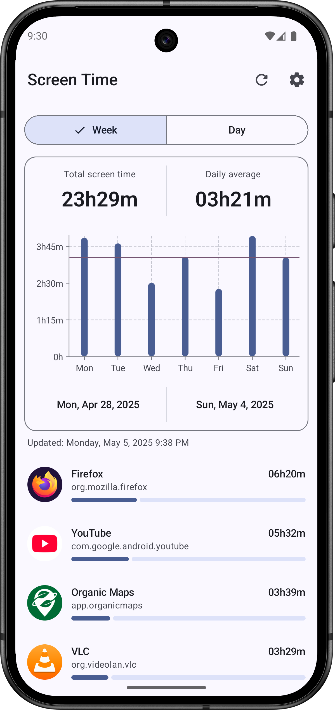
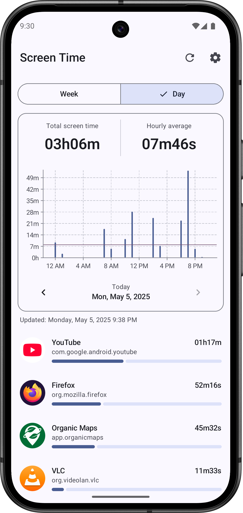
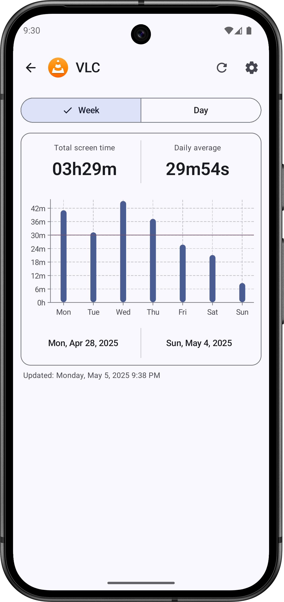
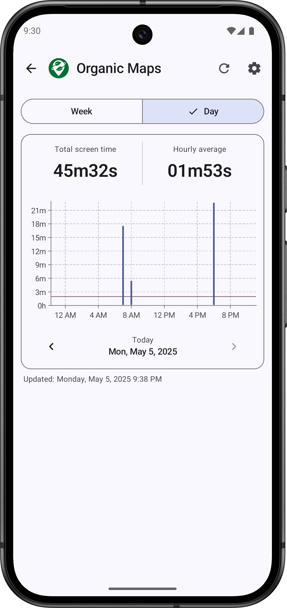
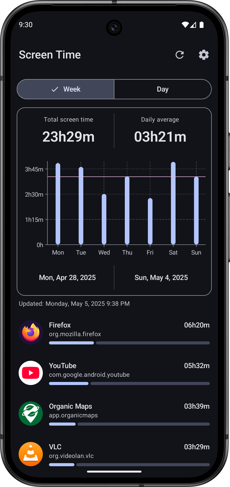
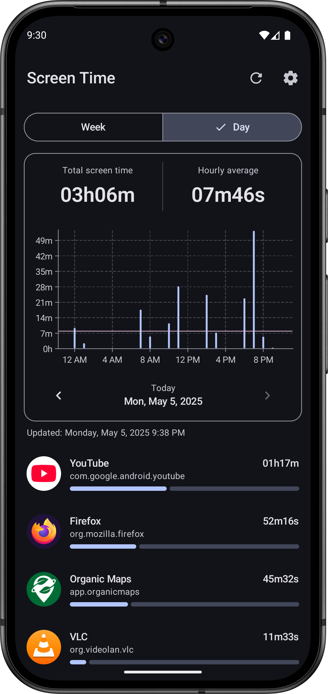
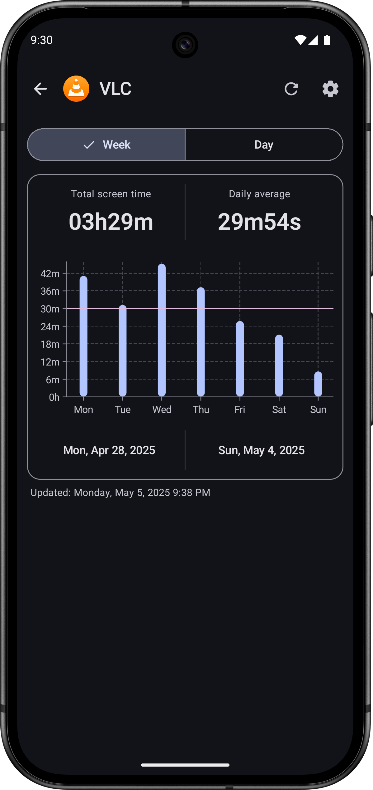
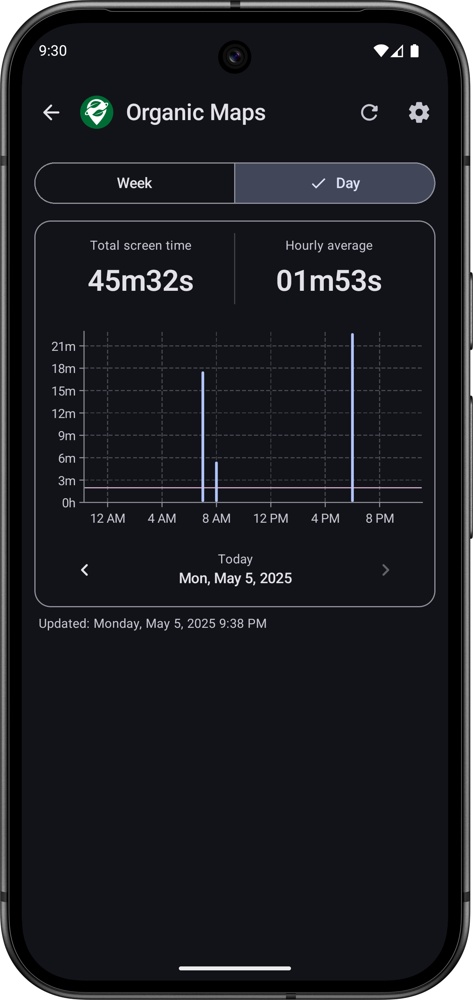

<div align="center"></div>

# <div align="center">Screen Time · 屏幕使用时间</div>

<div align="center">

一款查看设备与应用使用时长、点击量和长期趋势的 Android 应用

**由 美丽的黑莓 接手并主导维护 · 代码主要由 AI 辅助编写**

</div>

<div align="center">

[](https://github.com/annbnn183/MyScreenTime/releases)
[](https://www.gnu.org/licenses/gpl-3.0)

</div>

## 关于这个项目

这个项目现在由我（**美丽的黑莓**）接手。从功能规划、交互取舍到每个版本的发布，都由我推进；具体代码主要借助 AI 编写与迭代。应用内的主界面和「设置 → 关于」里也放了同样的说明。

在原开源项目的基础上，我陆续补上了这些能力：

- **日 / 周 / 月** 多周期查看，以及 **4 周、半年、一年（平均）** 的长期趋势视图：读取系统预聚合的长周期统计，历史更完整，也不卡顿。
- **应用四列网格排行**：可按使用时长 / 点击量 / 名称排序，附细进度条。
- **点击量与点击率**：统计各应用的打开次数及占比，并写入 CSV 报表。
- **每日屏幕使用目标提醒**：自定义目标时长与预警比例，每天在达标前提醒一次（Android 13+ 需通知权限）。
- **月度洞察**：最长使用日、活跃天数，以及 30 天目标日历（绿 = 达标，红 = 超标）。
- **CSV 导出 / 分享**：从顶部工具栏导出当前周期的每日汇总与应用排行。
- 单个应用的独立详情页、对比图表、主屏幕小组件。

同时保持原有的原则：**开源、无广告、不联网、不采集数据**。界面为 Material 3，使用 Kotlin + Jetpack Compose + Vico 开发。

## 下载

到 [GitHub Releases](https://github.com/annbnn183/MyScreenTime/releases) 下载最新 APK。

> 从 **v1.0.7** 起，所有构建使用同一份固定签名，新版本可以直接覆盖安装。如果你还在用 v1.0.4–v1.0.6，升级前请先卸载一次旧版本。

## 联系我

提需求、报 bug、聊想法，或者只是想认识一下，都欢迎：

| 方式 | 账号 |
| --- | --- |
| 微信 | `cookiebesting` |
| 邮箱 | [meilideheimei@Outlook.com](mailto:meilideheimei@Outlook.com) |

也可以直接在 [Issues](https://github.com/annbnn183/MyScreenTime/issues) 里留言。如果觉得这个项目有用，给仓库点个 Star 就是对我最大的支持。

## 打赏 / 支持我

如果你喜欢这个软件，可以给我打赏，支持我继续把它维护下去，谢谢你的鼓励。

**付款**：`广州市白云区棠下顺纺商行(cookiebesting)`　·　`#付款:广州市白云区棠下顺纺商行(cookiebesting)`

### 微信收款码

长按保存下图，用微信「扫一扫 → 相册」识别即可付款：

<div align="center">
  
</div>

### 复制到微信即可付款

复制下面这条链接，粘贴到微信里（发给「文件传输助手」或任意聊天窗口），点开即可付款：

```
https://payapp.wechatpay.cn/sjt/qr/AQEp0bAiFO50xLIWNTOrUoZE
```

> 上面的链接来自收款码本身，是微信支付的官方收款地址；需要在**微信内**打开才能发起付款，普通浏览器里无法完成支付。金额由你自行填写，谢谢支持。

## 界面截图










## 自动构建

推送到 `main` 会触发 [`.github/workflows/build.yml`](.github/workflows/build.yml)，构建 `assembleDefaultDebug`，用固定密钥签名后把 APK 发布到 Releases。**版本号以 [`app/build.gradle.kts`](app/build.gradle.kts) 的 `versionName` 为唯一来源**：Release 标签、Release 名称、APK 文件名（如 `MyScreenTime-v1.0.13.apk`）以及应用内「设置 → 关于」显示的版本都由它生成，因此始终一致；发布新版本只需同时递增 `versionName` 与 `versionCode`。签名密钥只存放在仓库的 Actions Secrets 中，不入库（见 `.gitignore`）。

## 许可证

代码沿用 [GNU General Public License v3 or later (GPL-3.0-or-later)](https://www.gnu.org/licenses/gpl-3.0)。

依赖许可证：

- [Core KTX](https://github.com/androidx/androidx) is licensed under [Apache License 2.0](https://www.apache.org/licenses/LICENSE-2.0)
- [Activity Compose](https://github.com/androidx/androidx) is licensed under [Apache License 2.0](https://www.apache.org/licenses/LICENSE-2.0)
- [Compose BOM](https://github.com/androidx/androidx) is licensed under [Apache License 2.0](https://www.apache.org/licenses/LICENSE-2.0)
- [Compose UI](https://github.com/androidx/androidx) is licensed under [Apache License 2.0](https://www.apache.org/licenses/LICENSE-2.0)
- [Compose UI Graphics](https://github.com/androidx/androidx) is licensed under [Apache License 2.0](https://www.apache.org/licenses/LICENSE-2.0)
- [Compose Material 3](https://github.com/androidx/androidx) is licensed under [Apache License 2.0](https://www.apache.org/licenses/LICENSE-2.0)
- [Compose Material Icons Extended](https://github.com/androidx/androidx) is licensed under [Apache License 2.0](https://www.apache.org/licenses/LICENSE-2.0)
- [Lifecycle Runtime Compose](https://github.com/androidx/androidx) is licensed under [Apache License 2.0](https://www.apache.org/licenses/LICENSE-2.0)
- [Navigation Compose](https://github.com/androidx/androidx) is licensed under [Apache License 2.0](https://www.apache.org/licenses/LICENSE-2.0)
- [DataStore Preferences](https://github.com/androidx/androidx) is licensed under [Apache License 2.0](https://www.apache.org/licenses/LICENSE-2.0)
- [Koin AndroidX Compose](https://github.com/InsertKoinIO/koin) is licensed under [Apache License 2.0](https://www.apache.org/licenses/LICENSE-2.0)
- [Vico](https://github.com/patrykandpatrick/vico) is licensed under [Apache License 2.0](https://www.apache.org/licenses/LICENSE-2.0)
- [Kotlin Serialization](https://github.com/Kotlin/kotlinx.serialization) is licensed under [Apache License 2.0](https://www.apache.org/licenses/LICENSE-2.0)

---

<div align="center">Screen Time · 美丽的黑莓</div>
