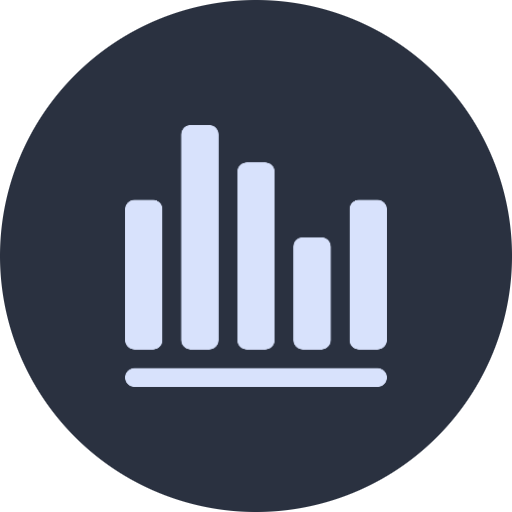
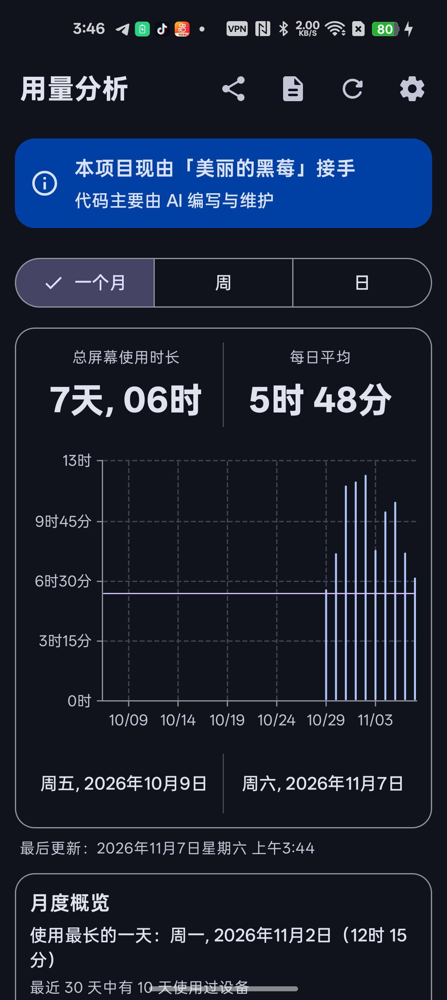
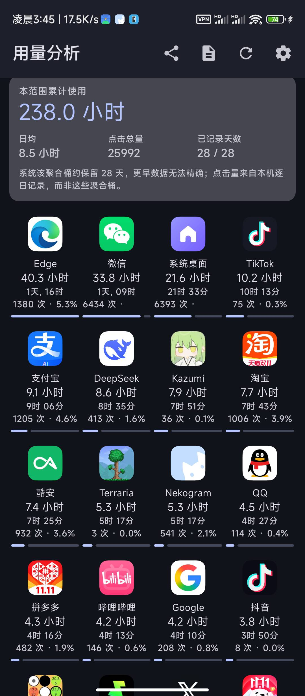
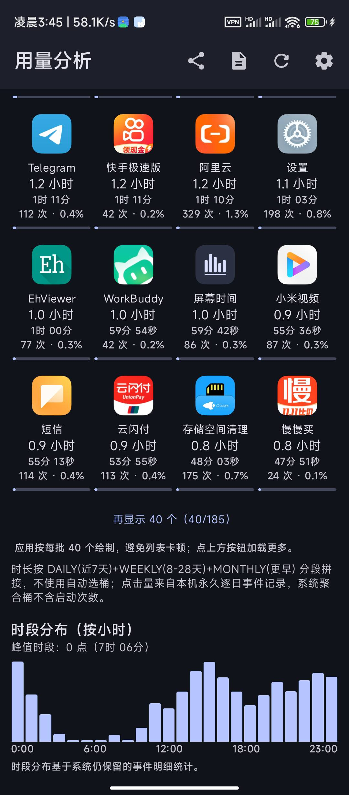
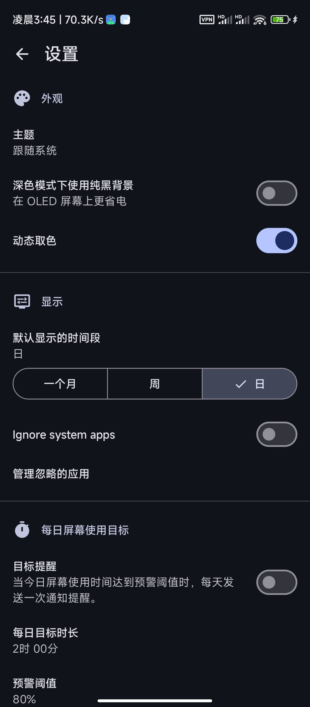
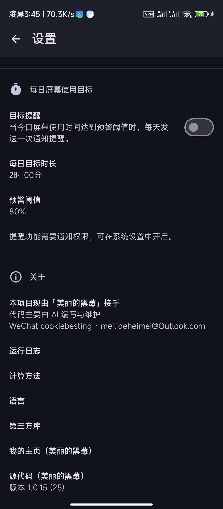

<div align="center"></div>

# <div align="center">Screen Time</div>

<div align="center">

An Android app for viewing device and app usage time, open counts, and long-term trends.

**Maintained and led by Beautiful Blackberry · Code mainly written with AI assistance**

</div>

<div align="center">

[](https://github.com/annbnn183/MyScreenTime/releases)
[](https://www.android.com)
[](https://kotlinlang.org)
[](https://www.gnu.org/licenses/gpl-3.0)
[](.github/workflows/build.yml)

</div>

<div align="center">

[中文](README.md) · English · [日本語](README_ja.md) · [한국어](README_ko.md) · [繁體中文](README_zh-TW.md)

</div>

---

## ✅ Current release: v1.0.30 (animated period navigation)

v1.0.30 turns the statistics area into four horizontal pages. Swipe left or right anywhere in the statistics content to move between Year / Month / Week / Day, with a native page-slide and snap animation. The period selector stays synchronized, and direct taps remain available. The existing vertical swipe between Overview and App Ranking is preserved.

This release changes navigation only: usage sources, calculations, history, database schema and backup format remain unchanged. The existing application ID and fixed signing certificate are retained; GitHub Actions verifies the package, version and certificate fingerprint before publishing. **Direct overwrite installation is confirmed only after that signature check passes.**

Back up important data regularly via **Settings → Data Management**. Please report any issue through Issues.

## 🆕 v1.0.30: swipe across the statistics content

- **Swipe the whole content area:** move between adjacent periods from either the Overview or App Ranking page; the gesture is no longer limited to the selector.
- **Smooth page animation:** native horizontal paging settles on a full page instead of stopping halfway.
- **Short, controlled gestures:** a lighter swipe switches one adjacent period at most, preventing accidental multi-period jumps.
- **Synchronized selector:** Year / Month / Week / Day selection follows the visible page; tapping any segment still jumps directly.
- **Vertical navigation retained:** vertical swipes still switch between Overview and App Ranking; horizontal and vertical gestures remain separate.
- **Data safety:** no changes to usage calculations, history, database schema, backup format or user data.

## 🧪 v1.0.22: diagnostic summaries that guide the next release

This release focuses on making exported diagnostics more useful, not simply collecting more logs:

- **A fixed rolling 24-hour window** keeps historical cumulative clicks, jank and query timings out of the current-period metrics. The report shows its exact start and end.
- **Faults first**: ERROR/FATAL, main-thread stalls/ANRs and system-reported process exits are highlighted.
- **Actionable performance metrics**: click-to-frame latency, interactive frame gaps, monitor discontinuities and query latency.
- **Memory evidence**: average/peak PSS, peak heap, minimum available system memory and sample count.
- **Screen-level clues**: the slowest clicks and queries include timestamps and screen names to help prioritize the next fix.
- **Original logs are untouched**: only the digest analysis and export description change. Full local history remains available, including recent 500 lines and full export.

Note: Android may report an older process exit only when the app starts again. The report calls this out so an old-version exit is not mistaken for a new-version failure.

## 🛠 v1.0.21: Performance and upgrade compatibility

- **Lower memory use:** daily / weekly / monthly results no longer retain full-size app `Drawable` objects for every installed app. Icons load on demand through the bounded downscaled LRU cache, including the app-detail title.
- **More trustworthy frame metrics:** when Choreographer pauses during background/idle periods, a gap over 10 seconds without recent interaction is recorded as `FRAME_MONITOR_GAP`, not `JANK`.
- **Direct in-place upgrade:** the APK is a non-debuggable, minified Release build, while intentionally retaining application ID `com.atharok.screentime.debug` to match the installed v1.0.20 package.
- **Signing guardrails:** GitHub Actions verifies package ID, version and the pinned certificate SHA-256 before publishing. If the fixed keystore is missing, the build fails instead of falling back to a temporary debug key.
- No database schema, backup format or user data is changed.

## 📑 Table of Contents

- [About this project](#about-this-project)
- [✨ Features](#-features)
- [📸 Screenshots](#-screenshots)
- [⬇️ Download](#️-download)
- [💬 Contact](#-contact)
- [☕ Donate / Support me](#-donate--support-me)
- [🧭 Product Strategy & Roadmap](#-product-strategy--roadmap)
- [⚙️ Automated build](#️-automated-build)
- [🔐 Checksums](#-checksums)
- [📄 License](#-license)

---

## About this project

This project is now maintained by me (**Beautiful Blackberry**). I drive everything from feature planning and UX trade-offs to each release; the actual code is mainly written and iterated with AI assistance. The same note appears on the app's main screen and in Settings → About.

On top of the original open-source project, I have added capabilities while sticking to one principle: **open source, no ads, no network access, no data collection**. The UI is Material 3, built with Kotlin + Jetpack Compose + Vico.

---

## ✨ Features

| 🗓️ Multi-period & long-term trends | 📊 App four-column grid ranking |
| :--- | :--- |
| Daily / weekly / monthly views, plus **4-week, half-year, and year (average)** long-term trend views: reads the system's pre-aggregated long-period stats, so history is more complete and never stutters. | Sortable by usage time / open count / name / **combined**, with fine progress bars and incremental "+40 more" loading. |
| 🖱️ Open count & share | 🎯 Daily screen-time goal reminder |
| Counts how many times each app was opened (brought to foreground) and its share, exported to CSV. | Custom target duration and warning ratio; reminds you once before reaching the goal each day (notification permission required on Android 13+). |
| 📈 Monthly insights | 📤 CSV export / share |
| Longest-usage day, active days, and a 30-day goal calendar (green = met, red = exceeded). | One-tap export of the current period's daily summary and app ranking from the top toolbar. |
| 🔍 Per-app details | 🧩 Home-screen widget |
| Independent detail page per app with comparison charts. | View usage on your home screen without opening the app. |

---

## 💾 Data management: backup, restore & migration

> A year of records is worth more than a fresh install. This release makes your data **fully back-up-able, safely restorable, and migratable to a new phone**.

**Backed up:** all settings (theme, default period, ignored apps, daily goal, auto-backup toggle…) and the permanent **per-day / per-app open-count history**.

**Not backed up (and cannot be):** screen-time **duration** and hourly distribution come from Android's `UsageStatsManager` — device-local system data that no app can export into another phone. This app backs up only what it owns and never fakes a "duration backup". After migration the new device accumulates duration from the day access is granted.

**Backup**
- Versioned JSON with export time, time zone, record counts and a SHA-256 checksum.
- After writing, the file is read back and compared; success is shown **only if identical** (otherwise "verification failed").
- Optional password encryption (AES-256-GCM + PBKDF2, random salt/IV). **A lost password cannot be recovered.**
- You choose where to save (internal storage, Downloads, SD card, Google Drive…) via the system file picker — never keep backups only in the app-private folder (deleted on uninstall).

**Restore (safety first)**
1. Validate: non-empty, ≤32 MB, valid JSON, supported version, checksum and record-count match.
2. Safety snapshot of the current data (memory + private file) plus a "restore in progress" marker.
3. Choose **Merge (keep current)** — history merged by max per day/app, so re-importing never doubles counts — or **Replace (overwrite)**.
4. Re-verify counts after restore.
5. Any failure **rolls back automatically** to the snapshot; no "half-restored" state.
6. Crash-safe: if the app is killed or power is lost mid-restore, the marker triggers an automatic rollback on next launch.

**Migrating to a new phone:** old phone → backup (optionally encrypted) to a copyable location → new phone installs the same-signature build → restore → choose Merge or Replace → re-grant "Usage access" when prompted (a special system permission that cannot travel in a file).

**Auto local backup:** one per day, keeps the latest 7, in the app-private external folder (deleted on uninstall — export manually to migrate).

**Delete all data:** writes a safety snapshot first, then clears settings and history.

**Version compatibility:** the backup format is independent of the database; files carry `format`/`schemaVersion`; **newer-format backups are rejected with a reason**, older ones are handled.

---

## 🗂 v1.0.20: logs short enough to paste into a chat

Sharing used to produce exactly one thing: a 1.6 MB TXT with 9,000 lines. Too big to send on WeChat, too long for an AI chat box, so the usual outcome was deleting most of it — losing the error lines that actually mattered.

This release splits export into three levels you choose from:

| Level | Size | When to use |
| :--- | :--- | :--- |
| Short digest | ~600 characters | Paste straight into WeChat / ChatGPT, fits one screen |
| Recent 500 lines | ~60 KB | Need context without handing over the whole history |
| Full log | several MB | Archiving, line-by-line review |

The copy button in the top bar now copies the **short digest**, which contains only:

- version, package, device model, Android version, ABI, usage-access state
- error count (ERROR / FATAL / crash / ANR) plus the latest raw lines
- abnormal exits (low-memory kill, ANR, crash), de-duplicated by reason
- key numbers: tap-to-frame (avg / worst), dropped frames, query cost (avg / worst)
- the 3 slowest taps and 2 slowest queries

The digest is capped at 1,500 characters. On overflow it drops slowest operations first, then the metrics block; **errors and device info are never dropped**.

> This also fixes a bug that made the statistics meaningless: Android returns the same exit list on every launch and the app wrote all of it again, so one kill appeared 8 times — the old log claimed "109 LOW_MEMORY exits" when only 13 had happened. Records are now keyed by reason + timestamp, and the digest merges historical duplicates too.

Logging policy is unchanged: **the full log is still captured forever and nothing is deleted**. This release only adds shorter ways to export it.

---

## 🏆 v1.0.19: combined ranking

The ranking could only be sorted by time or by opens, so an app used for hours but rarely opened could not be compared with one opened constantly for a few seconds each. This release adds a 4th sort option, **"Combined"**, that merges both into one list.

| Item | Details |
| :--- | :--- |
| Formula | Combined share = time share × w + open share × (1 − w). Both shares are relative to all apps in the selected range, so the combined shares add up to 100% |
| Why shares | Milliseconds and counts have different scales; adding raw values would let the bigger number dominate. Shares both live in 0–1 and can be weighted fairly |
| Three weights | Time first 7:3 / Balanced 5:5 (default) / Opens first 3:7 |
| Range | Follows the 4 weeks / 6 months / year chips above; day and week views use the current period |
| Each row | Rank, icon, name, time and its share, opens and their share, combined share |
| No open counts | Falls back to screen time only and says so, instead of ranking on a weight that is all zeros |
| Ties | Broken by time, then name, so the order is stable |
| First screen | Top 10; the rest expands on demand |

One small fix on the way: "show more" only appeared with more than 40 apps, so lists of 21–40 apps could not be expanded. It now follows the first-screen size, and "Show top 40 only" is now simply "Collapse".

> Caveat: open counts only cover the "days recorded" shown in the summary card, while time covers the whole range. When days recorded is far below the range length, the two windows differ and the combined ranking is indicative only.

## ⚡ v1.0.17 → v1.0.18: fixing what the runtime log actually showed

All recent releases follow one rule: fix only what the exported log actually shows, then verify with a freshly exported log. No optimisation without evidence.

| Symptom in the log | Root cause | Fix | Measured after shipping |
| :--- | :--- | :--- | :--- |
| **971 ms** first-frame stall | `DeviceUsageViewModel` called `runBlocking` on DataStore in its constructor | Render the first frame with the default period, read the preference asynchronously | `MAIN_THREAD_BLOCKED` no longer appears |
| **904 ms** long frame when results land | First screen composed 40 app cells + card + chart at once | First screen is 20 cells (one screen), rest expands on demand | Worst tap-to-frame **397 ms → 76 ms**, average 14 ms → 10 ms |
| "Backfill" needed **10+ taps** of 2–10 s | 31 days per tap, plus a full 10-day event rescan each time | 365 days in one run with live progress; caches only, no rescan | Log confirms `stored days: 366`, then `Backfilled 0 days` — fully automatic |
| PSS peak **1.36 GB**, process killed by the system | Every day rewrote the whole JSON (365 days = 365 full writes) | Batch-persist every 8 days; days past the event window are marked | PSS peak **1375 MB → 303 MB**, no more `LOW_MEMORY` kills |

### v1.0.18: making the log tell the truth

| Finding | Why it had to be fixed | What this release does |
| :--- | :--- | :--- |
| Most of the 922 `JANK` records were **false alarms** | The frame monitor counted "the UI is idle, so no new frames" as dropped frames — a 2.3 s "stall" appeared while taps rendered in 10 ms | Only intervals within 1.2 s of a touch count as real jank; idle intervals are logged separately as `IDLE_GAP` |
| Idle logging flooded the file | Up to one record per second, ~1.7 MB/day, slow exports | `IDLE_GAP` is summarised once per 30 s with the longest gap in that window |
| `jank=922` in the summary said nothing useful | Real and idle gaps were mixed | Summary has a separate `Idle gaps` line; the analysis prompt now says to read `CLICK_TO_FRAME` first |
| Backfill with 0 days still rebuilt the whole screen | No data changed, yet the UI stalled **627 ms** | Return early when nothing was backfilled |

> Logging policy is unchanged: every event is still kept forever. Recording "no new frame because the UI is idle" as jank was recording something that never happened — the idle duration is still fully preserved in `IDLE_GAP`.

## 📸 Screenshots

Real-device screenshots of **v1.0.15** (dark theme).

| Home · month view / monthly overview | App ranking · total time / four-column grid | App ranking · load more / hourly distribution |
| :---: | :---: | :---: |
|  |  |  |

| Settings · appearance / display / daily goal | Settings · about / run logs / version |
| :---: | :---: |
|  |  |

---

## ⬇️ Download

Download the latest APK from [GitHub Releases](https://github.com/annbnn183/MyScreenTime/releases).

> From **v1.0.7** onward, every build uses the same fixed signing key, so new versions can be installed as an in-place update. If you are still on v1.0.4–v1.0.6, uninstall the old version once before upgrading.

---

## 💬 Contact

Feature requests, bug reports, ideas, or just to say hi — all welcome:

| Method | Account |
| :--- | :--- |
| WeChat | `cookiebesting` |
| Email | [meilideheimei@Outlook.com](mailto:meilideheimei@Outlook.com) |

You can also leave a message in [Issues](https://github.com/annbnn183/MyScreenTime/issues). If you find this project useful, giving the repo a ⭐ Star is the biggest support.

---

## ☕ Donate / Support me

If you like this app, you can buy me a coffee to support me keeping it maintained. Thank you for the encouragement.

**Pay to**: `广州市白云区棠下顺纺商行(cookiebesting)`　·　`#付款:广州市白云区棠下顺纺商行(cookiebesting)`

### WeChat QR code

Long-press to save the image below, then use WeChat "Scan → Album" to recognize and pay:

<div align="center">
  
</div>

### Copy link to pay in WeChat

Copy the link below, paste it into WeChat (send to "File Transfer" or any chat), and tap to pay:

```
https://payapp.wechatpay.cn/sjt/qr/AQEp0bAiFO50xLIWNTOrUoZE
```

> The link above comes from the QR code itself and is WeChat Pay's official collection address; it must be opened **inside WeChat** to initiate payment and cannot complete payment in a normal browser. The amount is filled in by you. Thank you for your support.

---

## 🧭 Product Strategy & Roadmap

> **Core positioning**: MyScreenTime is not a phone anti-addiction app, but a **reliable, accurate, long-term, privacy-first personal digital-behavior statistics tool**.
> An anti-addiction tool tries to *change* user behavior; a statistics tool helps users *understand* their behavior. We prioritize doing the second thing well.

**My Digital Time Ledger** — record, count, compare, analyze, export, and let users know where their time actually went.

### Five product principles

1. **Data accuracy over feature count.**
2. **Long-term history over short-term leaderboards.**
3. **Privacy over cloud commercialization.**
4. **Users can export and control their own data.**
5. **Do not judge user behavior; only present the facts.**

### Roadmap (four phases)

| Phase | Priority | Period | Goal |
| :--- | :---: | :--- | :--- |
| 1 · Basic reliability | P0 | Month 1 | Make users trust every data point (accuracy; cross-midnight / timezone / reboot; Android version compatibility; permission & missing-data prompts; published calculation method) |
| 2 · Data analysis | P1 | Month 2 | From "how long" to "usage patterns" (24h distribution; weekday/weekend comparison; week/month over week/month; per-app history curve; time share; mean & median) |
| 3 · History & ownership | P2 | Month 3 | Keep and use your own data long-term (full backup; CSV/JSON import & export; custom range; cleanup & retention; integrity check) |
| 4 · Experience & ecosystem | Long-term | Months 4–6 | Always viewable, shareable, researchable (widget optimization; custom charts & sorting; app categorization; monthly/yearly reports; chart image export; i18n; F-Droid evaluation) |

### Core feature priorities

| Priority | Feature | Product value |
| :---: | :--- | :--- |
| **P0** | Usage-time accuracy | Foundation |
| **P0** | Historical data completeness | Long-term value |
| **P0** | App open count | Differentiation |
| **P0** | CSV / JSON data management | Ownership |
| **P1** | 24-hour distribution heatmap | Discover patterns |
| **P1** | Week / month over week | Discover change |
| **P1** | Per-app long-term trend | Deep analysis |
| **P1** | App categorization | Understand allocation |
| **P2** | Yearly report | Long-term review |
| **P2** | Home widget | Convenience |
| **P3** | Multi-device merge | Extensibility |

### Key technical point: separate long-term and short-term data

Android's `UsageStatsManager` has two different interfaces:

- `queryUsageStats`: queries the system's **aggregated** app usage stats (good for long-term duration).
- `queryEvents`: queries app usage **events**; the official docs state event records are **kept for only a few days** and cannot be used to reconstruct every open from half a year ago.

> Therefore we adopt a "daily summary, long-term save" storage strategy: usage time, open count, and hourly distribution are all **summarized daily and saved long-term**; raw events are not relied upon long-term from the system; necessary historical mappings of app info are saved. Even if Android clears old events, the accumulated history will not disappear.

**Terminology unification**: an app coming to the foreground is not the same as how many times the screen was actually tapped, so this repo uniformly uses "**open count**" and "**open count share**" instead of "click count / click rate".

### Four competitive moats

1. **Long-term history** — not just today, but look back over the past year, three years, or even longer.
2. **Data granularity** — not just app rankings, but hourly distribution, open counts, time share, and period comparisons.
3. **Data ownership** — offline use, local save, backup, export, migration; no platform lock-in.
4. **Statistical credibility** — publish the calculation method, explain data sources, missing cases, and estimation error; never fake a false sense of precision.

### Metrics (not just Stars)

| Metric | Purpose |
| :--- | :--- |
| Statistics error rate | Is data trustworthy |
| 30-day continuous data completeness | Is it reliable |
| Crash rate | Stability |
| Cold-start time | UX |
| Data export success rate | Data ownership |
| 30-day retention | Long-term value |
| Feedback resolution rate | Maintenance quality |

> Note: high 30-day retention does not necessarily mean a great product (users may only check occasionally); judge comprehensively with data completeness, usage frequency, and real feedback.

### Strategy summary

MyScreenTime does not need to become the screen-time app with the most features, but the screen-time **data recording tool its users trust most**.

> **Record the facts, accumulate history, analyze patterns, and return the interpretation of data to the user.**

<details>
<summary>📋 Detailed roadmap checklist (click to expand)</summary>

**Phase 1 · Basic reliability (P0)**
- [ ] Check screen-usage-time accuracy
- [ ] Check data across midnight, timezone changes, and reboots
- [ ] Validate data compatibility across Android versions
- [ ] Check app open-count statistics
- [ ] Provide prompts for missing data and disabled permissions
- [ ] Clarify the calculation method for each statistic

**Phase 2 · Data analysis (P1)**
- [ ] 24-hour usage distribution chart
- [ ] Weekday vs weekend comparison
- [ ] This week vs last week
- [ ] This month vs last month
- [ ] Per-app historical change curve
- [ ] App usage time as a share of total time
- [ ] Daily average usage and median

**Phase 3 · History & ownership (P2)**
- [ ] Full historical data backup
- [ ] CSV import & export
- [ ] JSON backup & restore
- [ ] Custom date-range query
- [ ] Data cleanup & log retention settings
- [ ] Statistical data integrity check

**Phase 4 · Experience & ecosystem (long-term)**
- [ ] Home widget optimization
- [ ] Custom charts and sorting
- [ ] App categorization statistics
- [ ] Monthly / yearly reports
- [ ] Chart image export
- [ ] i18n refinement
- [ ] F-Droid publishing feasibility evaluation

**Not investing for now** (may raise cost without necessarily improving core value): AI chat assistant, social leaderboards, forced app locking, complex subscriptions, cloud account system, lots of statistics-unrelated features.

**Differentiation references (competitors)**
- *Android Digital Wellbeing*: system-integrated, mature permission flow; weakness is inconsistent vendor implementation and history analysis → our opportunity is long-period stats and export.
- *Screen Time*: no ads, no collection, hourly charts and widgets → we strengthen long-term trends, open counts, and deep analysis.
- *Lumen*: feature-rich → we don't chase breadth, we make the statistics experience professional.

</details>

---

## ⚙️ Automated build

Pushing to `main` triggers [`.github/workflows/build.yml`](.github/workflows/build.yml), which builds `assembleDefaultRelease`, signs it with a fixed key, and publishes the APK to Releases. **The version number takes [`app/build.gradle.kts`](app/build.gradle.kts)'s `versionName` as the single source of truth**: the Release tag, Release name, APK file name (e.g. `MyScreenTime-v1.0.22.apk`), and the version shown in Settings → About are all generated from it, so they always match; to publish a new version, just bump both `versionName` and `versionCode`. The signing key lives only in the repo's Actions Secrets and is not committed (see `.gitignore`).

---

## 🔐 Checksums

To verify the authenticity and integrity of the released APK, compare its signing certificate fingerprints against the values below:

```
SHA-256: d075b5e1611b318d9e2f11e62d2bfebe0afbed51c17f935ba701d233d3fef501
SHA-1: 57839e6c38b7821da9c9c80767e7cedf9d8b5eab
MD5: bf656b4b431a1a688a9b2fa69b430e9e
```

Certificate subject: `CN=MyScreenTime, OU=OpenSource, O=MyScreenTime, L=Beijing, ST=Beijing, C=CN`. Every APK released from this repository is signed with the same fixed key, so a matching signature means it can be installed over the previous version without uninstalling.

---

## 📄 License

Code is licensed under [GNU General Public License v3 or later (GPL-3.0-or-later)](https://www.gnu.org/licenses/gpl-3.0).

Dependency licenses:

- [Core KTX](https://github.com/androidx/androidx) is licensed under [Apache License 2.0](https://www.apache.org/licenses/LICENSE-2.0)
- [Activity Compose](https://github.com/androidx/androidx) is licensed under [Apache License 2.0](https://www.apache.org/licenses/LICENSE-2.0)
- [Compose BOM](https://github.com/androidx/androidx) is licensed under [Apache License 2.0](https://www.apache.org/licenses/LICENSE-2.0)
- [Compose UI](https://github.com/androidx/androidx) is licensed under [Apache License 2.0](https://www.apache.org/licenses/LICENSE-2.0)
- [Compose UI Graphics](https://github.com/androidx/androidx) is licensed under [Apache License 2.0](https://www.apache.org/licenses/LICENSE-2.0)
- [Compose Material 3](https://github.com/androidx/androidx) is licensed under [Apache License 2.0](https://www.apache.org/licenses/LICENSE-2.0)
- [Compose Material Icons Extended](https://github.com/androidx/androidx) is licensed under [Apache License 2.0](https://www.apache.org/licenses/LICENSE-2.0)
- [Lifecycle Runtime Compose](https://github.com/androidx/androidx) is licensed under [Apache License 2.0](https://www.apache.org/licenses/LICENSE-2.0)
- [Navigation Compose](https://github.com/androidx/androidx) is licensed under [Apache License 2.0](https://www.apache.org/licenses/LICENSE-2.0)
- [DataStore Preferences](https://github.com/androidx/androidx) is licensed under [Apache License 2.0](https://www.apache.org/licenses/LICENSE-2.0)
- [Koin AndroidX Compose](https://github.com/InsertKoinIO/koin) is licensed under [Apache License 2.0](https://www.apache.org/licenses/LICENSE-2.0)
- [Vico](https://github.com/patrykandpatrick/vico) is licensed under [Apache License 2.0](https://www.apache.org/licenses/LICENSE-2.0)
- [Kotlin Serialization](https://github.com/Kotlin/kotlinx.serialization) is licensed under [Apache License 2.0](https://www.apache.org/licenses/LICENSE-2.0)

---

<div align="center">Screen Time · Beautiful Blackberry</div>
