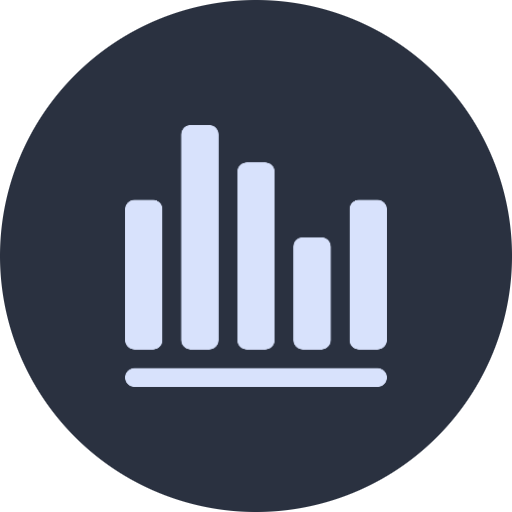
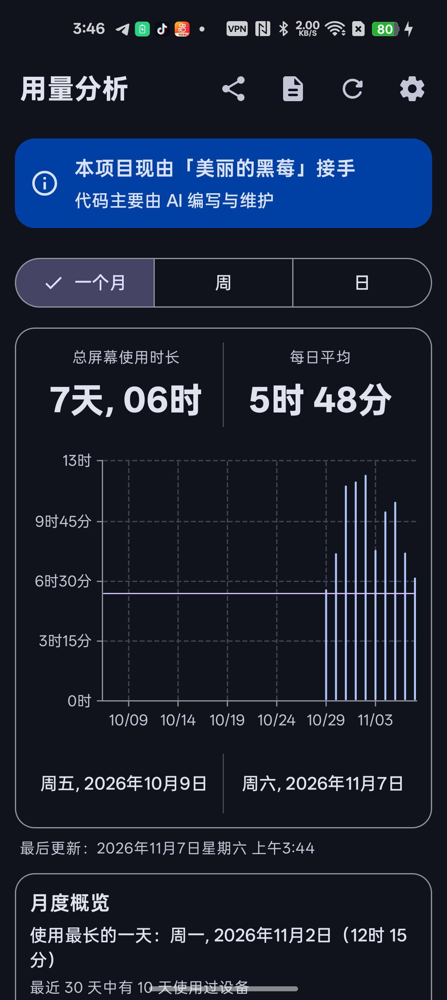
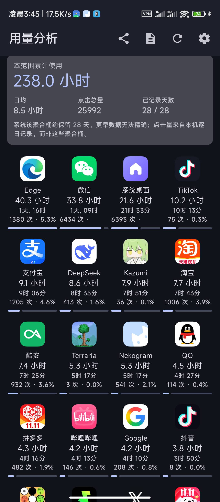
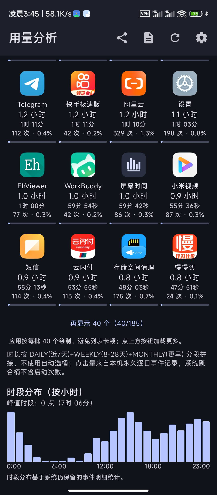
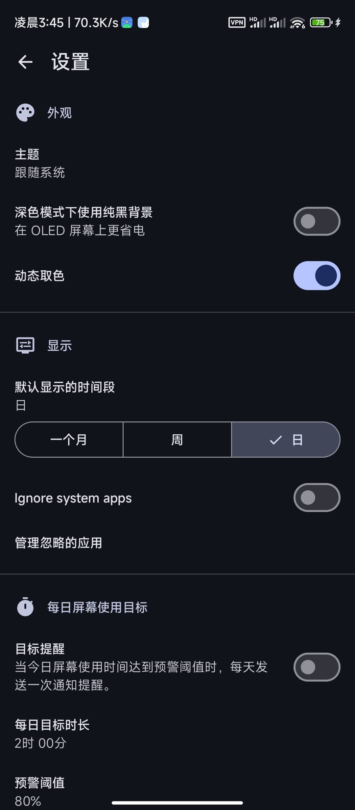
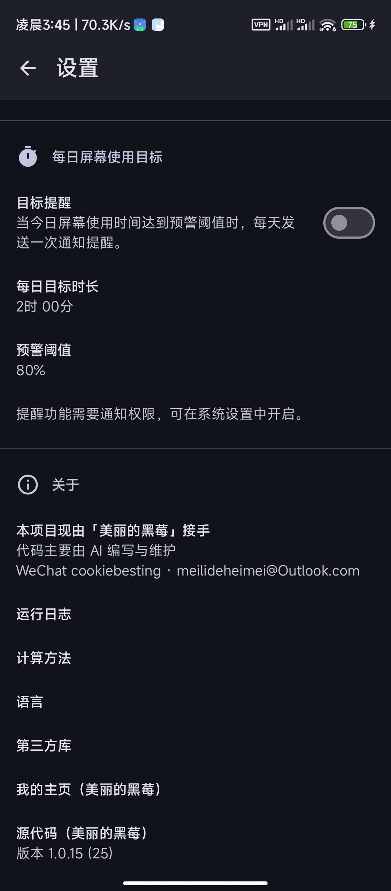

<div align="center"></div>

# <div align="center">Screen Time（画面使用時間）</div>

<div align="center">

端末とアプリの使用時間・起動回数・長期トレンドを確認できる Android アプリ。

**维护・主宰：美しいブラックベリー（Beautiful Blackberry）・コードは主に AI の支援で記述**

</div>

<div align="center">

[](https://github.com/annbnn183/MyScreenTime/releases)
[](https://www.android.com)
[](https://kotlinlang.org)
[](https://www.gnu.org/licenses/gpl-3.0)
[](.github/workflows/build.yml)

</div>

<div align="center">

[中文](README.md) · [English](README_en.md) · 日本語 · [한국어](README_ko.md) · [繁體中文](README_zh-TW.md)

</div>

---

## 📑 目次

- [このプロジェクトについて](#このプロジェクトについて)
- [✨ 機能](#-機能)
- [📸 スクリーンショット](#-スクリーンショット)
- [⬇️ ダウンロード](#️-ダウンロード)
- [💬 連絡先](#-連絡先)
- [☕ 寄付 / 応援](#-寄付--応援)
- [🧭 プロダクト戦略とロードマップ](#-プロダクト戦略とロードマップ)
- [⚙️ 自動ビルド](#️-自動ビルド)
- [🔐 チェックサム](#-チェックサム)
- [📄 ライセンス](#-ライセンス)

---

## このプロジェクトについて

このプロジェクトは現在、私（**美しいブラックベリー**）が引き継いで维护しています。機能計画、UX の取捨選択から各リリースまで私が主導し、実際のコードは主に AI の支援で記述・反復改善しています。同じ説明はアプリのメイン画面と「設定 → 概要」にもあります。

オリジナルのオープンソースプロジェクトを土台に、次の機能を順に追加しました。守っている原則は一つ：**オープンソース、広告なし、ネット通信なし、データ収集なし**。UI は Material 3 で、Kotlin + Jetpack Compose + Vico で開発しています。

---

## ✨ 機能

| 🗓️ 複数期間・長期トレンド | 📊 アプリ 4 列グリッドランキング |
| :--- | :--- |
| 日 / 週 / 月の表示に加え、**4 週間・半年・1 年（平均）** の長期トレンド表示。システムの事前集計された長期統計を読むため、履歴がより完全で、カクつきもありません。 | 使用時間 / 起動回数 / 名前で並べ替え可能、細かいプログレスバー付き、「あと 40 件」の増分読み込み対応。 |
| 🖱️ 起動回数と占有率 | 🎯 1 日の画面使用目標リマインダー |
| 各アプリの起動（フォアグラウンドへの移動）回数と占有率を集計し、CSV に出力。 | 目標時間と警告比率をカスタム。毎日目標達成前に 1 回通知（Android 13+ は通知権限が必要）。 |
| 📈 月間インサイト | 📤 CSV 出力 / 共有 |
| 最長使用日、アクティブ日数、30 日目標カレンダー（緑＝達成、赤＝超過）。 | トップツールバーから現在の期間の日次サマリーとアプリランキングをワンタップ出力。 |
| 🔍 アプリ別詳細 | 🧩 ホーム画面ウィジェット |
| アプリごとの独立した詳細ページ（比較チャート付き）。 | アプリを開かずにホーム画面で使用状況を確認。 |

---

## 💾 データ管理：バックアップ・復元・移行

> 1 年分の記録は、インストール直後より価値があります。今回の更新は、データを**完全にバックアップでき、安全に復元でき、新しい端末へ移行できる**ことに重点を置いています。

**バックアップされるもの：** すべての設定（テーマ、既定の期間、除外アプリ、毎日の目標、自動バックアップのオン/オフなど）と、**日別・アプリ別の起動回数の永久履歴**。

**バックアップされない（できない）もの：** 使用**時間**と時間帯分布は Android の `UsageStatsManager` に由来する**端末固有のシステムデータ**で、どのアプリも他の端末へ書き出すことはできません。本アプリは自分が保持するデータのみを正直にバックアップし、「時間のバックアップ」を偽装しません。移行後、新しい端末では権限を付与した日から時間が蓄積されます。

**バックアップ**
- 版番号・書き出し時刻・タイムゾーン・件数・SHA-256 チェックサムを含む JSON。
- 書き込み後に読み戻して照合し、**一致したときだけ成功**を表示（不一致は「検証失敗」）。
- 任意のパスワード暗号化（AES-256-GCM + PBKDF2、ランダム salt/IV）。**パスワードを忘れると復元できません。**
- 保存先はシステムのファイル選択で自由に指定（内部ストレージ / ダウンロード / SD カード / Google Drive など）。アプリ専用フォルダだけに置かないでください（アンインストールで消えます）。

**復元（安全第一）**
1. 検証：空でない・≤32MB・正しい JSON・対応バージョン・チェックサムと件数の一致。
2. 現在データの安全スナップショット（メモリ＋専用ファイル）と「復元中」マーカー。
3. **マージ（現状を保持）**（履歴は日別・アプリ別に最大値を採用するため再インポートでも二重計上しない）または**上書き（置換）**を選択。
4. 復元後に件数を再検証。
5. 失敗時は**自動でスナップショットへロールバック**。中途半端な状態を残しません。
6. クラッシュ安全：復元中に強制終了・電源断でも、次回起動時にマーカーを検出して自動ロールバック。

**新しい端末への移行：** 旧端末 → バックアップ（必要なら暗号化）をコピー可能な場所へ → 新端末に同一署名のビルドを導入 → 復元 → マージ/上書きを選択 → 促されたら「使用状況へのアクセス」を再付与（ファイルでは移行できない特別なシステム権限）。

**自動ローカルバックアップ：** 1 日 1 回、最新 7 件を保持、アプリ専用外部フォルダに保存（アンインストールで削除。移行は手動書き出しで）。

**すべてのデータを削除：** 先に安全スナップショットを作成してから設定と履歴を消去。

**バージョン互換性：** バックアップ形式はデータベースと独立。`format`/`schemaVersion` を持ち、**より新しい形式のバックアップは理由付きで拒否**、古いものは処理します。

---

## ⚡ v1.0.17 体感改善（実際の実行ログに基づく）

新機能は追加せず、ユーザーが実際に遭遇したカクつきと繰り返し操作だけを直しました。いずれも書き出された実行ログ（2,128 イベント、504 件のジャンク、ERROR/CRASH は 0 件）から特定しています。

| ログの現象 | 原因 | 今回の対応 |
| :--- | :--- | :--- |
| 初回フレームで **971 ms** の停止 | `DeviceUsageViewModel` のコンストラクタで `runBlocking` により DataStore を読み、メインスレッドを塞いでいた | 先に既定の期間で描画し、設定は非同期で読み込む |
| スキャン結果の反映時に **904 ms** の長いフレーム | 最初の画面で 40 個のアプリセル＋カード＋グラフを一度に構築していた | 最初は 20 個（1 画面分）だけ構築し、残りは必要時に展開 |
| 「クリック数の補算」を **10 回以上**手動で押す必要（1 回 2〜10 秒） | 1 回で 31 日しか進まず、しかも毎回 10 日分のイベントを全走査していた | 1 回で 365 日まで補算。進捗を表示し、完了後はイベントを再走査しない |
| 補算中の PSS ピークが **1.36 GB** | 1 日ごとに JSON 全体を書き直していた（365 日＝365 回の全書き込み） | 8 日分をまとめて書き込み、システムのイベント保持期間（21 日）より古い日は問い合わせずに記録のみ |
| ユーザー自身が「クリック数が不足」と気づく必要があった | 自動実行がなかった | ホーム画面の読み込み後に 1 回だけ自動で補算（既に走査済みの日はスキップ） |
| 自動バックアップがスイッチだけで状態不明 | 状態表示がなかった | 設定に「前回のバックアップ・サイズ・保持数」を表示 |

> ログは従来どおり全件を永久保存します。今回の変更は「重複した走査」と「重複した書き込み」を減らすだけです。

## 📸 スクリーンショット

**v1.0.15** の実機スクリーンショット（ダークテーマ）。

| ホーム・月ビュー / 月間概要 | アプリランキング・合計時間 / 4 列グリッド | アプリランキング・さらに表示 / 時間帯分布 |
| :---: | :---: | :---: |
|  |  |  |

| 設定・外観 / 表示 / 1 日の目標 | 設定・概要 / 実行ログ / バージョン |
| :---: | :---: |
|  |  |

---

## ⬇️ ダウンロード

最新の APK は [GitHub Releases](https://github.com/annbnn183/MyScreenTime/releases) からダウンロードしてください。

> **v1.0.7** 以降、すべてのビルドで同一の固定署名を使用しているため、新しいバージョンは上書きインストールできます。v1.0.4–v1.0.6 をお使いの場合は、アップグレード前に一度旧バージョンをアンインストールしてください。

---

## 💬 連絡先

機能要望、バグ報告、アイデア、または単に挨拶でも歓迎です：

| 方法 | アカウント |
| :--- | :--- |
| WeChat | `cookiebesting` |
| メール | [meilideheimei@Outlook.com](mailto:meilideheimei@Outlook.com) |

[Issues](https://github.com/annbnn183/MyScreenTime/issues) に直接メッセージを残すこともできます。このプロジェクトが役立てば、リポジトリに ⭐ Star を付けていただくのが何よりの支援です。

---

## ☕ 寄付 / 応援

このアプリが気に入ったら、これからも維持できるよう寄付（サポート）していただけると嬉しいです。応援ありがとうございます。

**支払先**：`广州市白云区棠下顺纺商行(cookiebesting)`　·　`#付款:广州市白云区棠下顺纺商行(cookiebesting)`

### WeChat 受取 QR コード

下の画像を長押しで保存し、WeChat の「スキャン → アルバム」で認識して支払ってください：

<div align="center">
  
</div>

### リンクをコピーして WeChat で支払う

下のリンクをコピーし、WeChat に貼り付け（「ファイル転送」や任意のチャットに送信）してタップすると支払えます：

```
https://payapp.wechatpay.cn/sjt/qr/AQEp0bAiFO50xLIWNTOrUoZE
```

> 上のリンクは QR コード本体から取得した WeChat Pay 公式の受取アドレスです。**WeChat 内**で開く必要があり、通常のブラウザでは支払いを完了できません。金額はご自身で入力してください。応援ありがとうございます。

---

## 🧭 プロダクト戦略とロードマップ

> **コアポジション**：MyScreenTime はスマホの依存対策アプリではなく、**信頼でき、正確で、長期間・プライバシー優先の個人デジタル行動統計ツール**です。
> 依存対策ツールはユーザーの行動を*変えよう*とし、統計ツールはユーザーが自らの行動を*理解する*手助けをします。私たちは後者をしっかりやります。

**私のデジタルタイムレジャー** —— 記録・集計・比較・分析・出力し、時間が本当にどこへ行ったかをユーザーに気づかせます。

### 5 つのプロダクト原則

1. **データの正確さを、機能の多さより優先する。**
2. **短期のランキングより、長期の履歴を優先する。**
3. **クラウドの商用化より、プライバシーを優先する。**
4. **ユーザーが自身のデータを出力・管理できるようにする。**
5. **ユーザーの行動を評価せず、事実だけを提示する。**

### ロードマップ（4 段階）

| 段階 | 優先度 | 期間 | 目標 |
| :--- | :---: | :--- | :--- |
| 1・基盤の信頼性 | P0 | 1 ヶ月目 | すべての数値を信じてもらう（正確さ；日跨ぎ／タイムゾーン／再起動；Android バージョン互換；権限と欠損の案内；計算方法の公開） |
| 2・データ分析力 | P1 | 2 ヶ月目 | 「どれだけ使ったか」から「使用パターン」へ（24 時間分布；平日／週末比較；週／月の前同期比；アプリ別履歴曲線；時間占有率；平均と中央値） |
| 3・履歴と主体性 | P2 | 3 ヶ月目 | 自身のデータを長期保存・活用（完全バックアップ；CSV/JSON 入出力；期間指定；削除と保持設定；完全性チェック） |
| 4・体験とエコシステム | 長期 | 4〜6 ヶ月目 | いつでも見られ、共有・研究できる（ウィジェット改善；チャートと並びのカスタム；アプリ分類；月報／年報；チャート画像出力；多言語；F-Droid 評価） |

### コア機能の優先度

| 優先度 | 機能 | プロダクト価値 |
| :---: | :--- | :--- |
| **P0** | 使用時間の正確さ | 基盤 |
| **P0** | 履歴データの完全性 | 長期価値 |
| **P0** | アプリ起動回数 | 差別化 |
| **P0** | CSV / JSON データ管理 | 主体性 |
| **P1** | 24 時間分布ヒートマップ | パターン発見 |
| **P1** | 週／月の前同期比 | 変化の発見 |
| **P1** | アプリ別長期トレンド | 深い分析 |
| **P1** | アプリ分類統計 | 時間配分の理解 |
| **P2** | 年次レポート | 長期振り返り |
| **P2** | ホームウィジェット | 利便性 |
| **P3** | 複数端末の統合 | 拡張性 |

### 技術の要点：長期と短期の分離

Android の `UsageStatsManager` には 2 種類の異なるインターフェースがあります：

- `queryUsageStats`：システムの**集計済み**アプリ使用統計を取得（長期時間向き）。
- `queryEvents`：アプリの使用**イベント**を取得。公式ドキュメントによればイベント記録は**数日しか保持されず**、半年前のすべての起動をここから復元することはできません。

> そのため「日次集計・長期保存」の保存戦略を採ります。使用時間・起動回数・時間帯分布はすべて**日ごとに集計して長期保存**し、生イベントはシステムの記録に長期依存しません。アプリ情報の必要な履歴マッピングだけを保存します。Android が古いイベントを削除しても、蓄積した履歴は消えません。

**用語の統一**：アプリがフォアグラウンドになったことと、画面を実際に何回タップしたかは別なので、本リポジトリでは「クリック数 / クリック率」ではなく「**起動回数 / 起動回数占有率**」を統一して使います。

### 4 つの競争優位性

1. **長期履歴** —— 今日だけでなく、1 年・3 年・それ以上前の個人の変化も振り返れる。
2. **データの粒度** —— アプリランキングだけでなく、時間帯分布・起動回数・時間占有率・期間比較も。
3. **データの主体性** —— オフライン利用、ローカル保存、バックアップ、出力、移行ができ、プラットフォームにロックされない。
4. **統計の信頼性** —— 計算方法を公開し、データソース・欠損・推定誤差を説明。いい加減な「正確さ」は作らない。

### 評価指標（Stars だけを見ない）

| 指標 | 目的 |
| :--- | :--- |
| 統計誤差率 | データは信頼できるか |
| 30 日連続データ完全率 | 信頼できるか |
| クラッシュ率 | 安定性 |
| コールドスタート時間 | 体験 |
| データ出力成功率 | データ主体性 |
| 30 日リテンション | 長期価値 |
| フィードバック解決率 | 维护品質 |

> 補足：30 日リテンションが高いからといって必ずしも優れたプロダクトとは限りません（たまに見るだけの場合も）。データ完全性・利用頻度・実際のフィードバックを総合して判断してください。

### 戦略まとめ

MyScreenTime は機能最多の画面使用時間アプリになる必要はなく、ユーザーが**最も信頼する画面使用時間のデータ記録ツール**になることです。

> **事実を記録し、履歴を蓄積し、パターンを分析し、データの解釈をユーザーに返す。**

<details>
<summary>📋 ロードマップ詳細チェックリスト（クリックで展開）</summary>

**段階 1・基盤の信頼性（P0）**
- [ ] 画面使用時間の統計正確さを確認
- [ ] 日跨ぎ・タイムゾーン変更・再起動後のデータを確認
- [ ] 複数 Android バージョンでの互換性を検証
- [ ] アプリ起動回数統計を確認
- [ ] データ欠損・権限オフの案内を提供
- [ ] 各統計の計算方法を明確化

**段階 2・データ分析力（P1）**
- [ ] 24 時間使用分布チャート
- [ ] 平日と週末の比較
- [ ] 今週と先週の比較
- [ ] 今月と先月の比較
- [ ] アプリごとの履歴変化曲線
- [ ] アプリ使用時間の全体占有率
- [ ] 1 日平均使用時間と中央値

**段階 3・履歴と主体性（P2）**
- [ ] 完全な履歴データのバックアップ
- [ ] CSV 入出力
- [ ] JSON バックアップと復元
- [ ] カスタム期間の検索
- [ ] データ削除とログ保持設定
- [ ] 統計データ完全性チェック

**段階 4・体験とエコシステム（長期）**
- [ ] ホームウィジェット改善
- [ ] カスタムチャートと並び
- [ ] アプリ分類統計
- [ ] 月報／年報
- [ ] チャート画像出力
- [ ] 多言語の充実
- [ ] F-Droid 公開の実現可能性評価

**現時点では投資しない**（コスト増でも中核価値を高めない可能性があるもの）：AI チャットアシスタント、ソーシャルランキング、強制アプリロック、複雑なサブスクリプション、クラウドアカウント、統計と無関係な多数の機能。

**差別化の参考（競合）**
- *Android デジタルウェルビーイング*：システム統合、権限フローが成熟。弱点はベンダー実装と履歴分析体験のばらつき → 機会は長期統計と出力。
- *Screen Time*：広告なし、収集なし、時間チャートとウィジェット → 長期トレンド・起動回数・深い分析を強化。
- *Lumen*：機能豊富 → 幅広さではなく統計体験のプロ化を目指す。

</details>

---

## ⚙️ 自動ビルド

`main` へのプッシュで [`.github/workflows/build.yml`](.github/workflows/build.yml) が起動し、`assembleDefaultDebug` をビルド、固定キーで署名して APK を Releases に公開します。**バージョン番号は [`app/build.gradle.kts`](app/build.gradle.kts) の `versionName` を単一の情報源**とします。Release タグ・Release 名・APK ファイル名（例 `MyScreenTime-v1.0.17.apk`）・設定 → 概要に表示されるバージョンはすべてここから生成されるため常に一致します。新バージョン公開時は `versionName` と `versionCode` を同時に増やすだけです。署名キーはリポジトリの Actions Secrets のみにあり、コミットされません（`.gitignore` 参照）。

---

## 🔐 チェックサム

リリースされた APK の真正性と完全性を検証するため、署名証明書の指紋を以下の値と照合してください。

```
SHA-256: d075b5e1611b318d9e2f11e62d2bfebe0afbed51c17f935ba701d233d3fef501
SHA-1: 57839e6c38b7821da9c9c80767e7cedf9d8b5eab
MD5: bf656b4b431a1a688a9b2fa69b430e9e
```

証明書のサブジェクト： `CN=MyScreenTime, OU=OpenSource, O=MyScreenTime, L=Beijing, ST=Beijing, C=CN`。本リポジトリからリリースされるすべての APK は同一の固定鍵で署名されているため、署名が一致すればアンインストールせずに上書きインストールできます。

---

## 📄 ライセンス

コードのライセンスは [GNU General Public License v3 or later (GPL-3.0-or-later)](https://www.gnu.org/licenses/gpl-3.0) を引き継いでいます。

依存ライブラリのライセンス：

- [Core KTX](https://github.com/androidx/androidx) is licensed under [Apache License 2.0](https://www.apache.org/licenses/LICENSE-2.0)
- [Activity Compose](https://github.com/androidx/androidx) is licensed under [Apache License 2.0](https://www.apache.org/licenses/LICENSE-2.0)
- [Compose BOM](https://github.com/androidx/androidx) is licensed under [Apache License 2.0](https://www.apache.org/licenses/LICENSE-2.0)
- [Compose UI](https://github.com/androidx/androidx) is licensed under [Apache License 2.0](https://www.apache.org/licenses/LICENSE-2.0)
- [Compose UI Graphics](https://github.com/androidx/androidx) is licensed under [Apache License 2.0](https://www.apache.org/licenses/LICENSE-2.0)
- [Compose Material 3](https://github.com/androidx/androidx) is licensed under [Apache License 2.0](https://www.apache.org/licenses/LICENSE-2.0)
- [Compose Material Icons Extended](https://github.com/androidx/androidx) is licensed under [Apache License 2.0](https://www.apache.org/licenses/LICENSE-2.0)
- [Lifecycle Runtime Compose](https://github.com/androidx/androidx) is licensed under [Apache License 2.0](https://www.apache.org/licenses/LICENSE-2.0)
- [Navigation Compose](https://github.com/androidx/androidx) is licensed under [Apache License 2.0](https://www.apache.org/licenses/LICENSE-2.0)
- [DataStore Preferences](https://github.com/androidx/androidx) is licensed under [Apache License 2.0](https://www.apache.org/licenses/LICENSE-2.0)
- [Koin AndroidX Compose](https://github.com/InsertKoinIO/koin) is licensed under [Apache License 2.0](https://www.apache.org/licenses/LICENSE-2.0)
- [Vico](https://github.com/patrykandpatrick/vico) is licensed under [Apache License 2.0](https://www.apache.org/licenses/LICENSE-2.0)
- [Kotlin Serialization](https://github.com/Kotlin/kotlinx.serialization) is licensed under [Apache License 2.0](https://www.apache.org/licenses/LICENSE-2.0)

---

<div align="center">Screen Time · 美しいブラックベリー</div>
