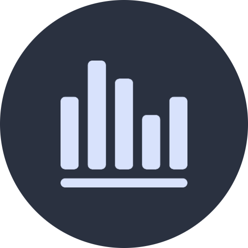
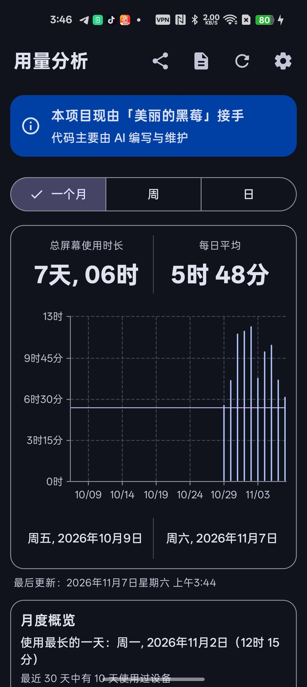
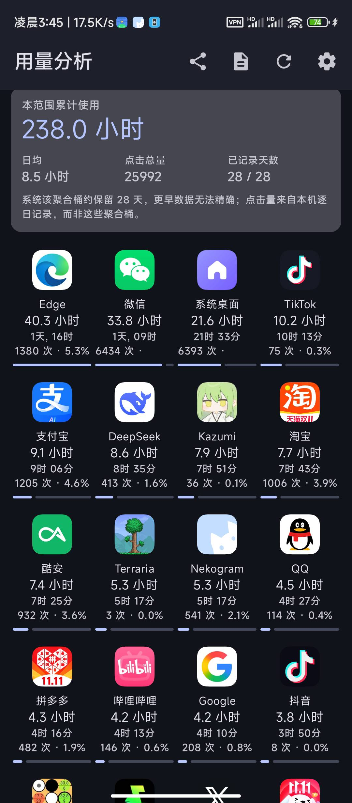
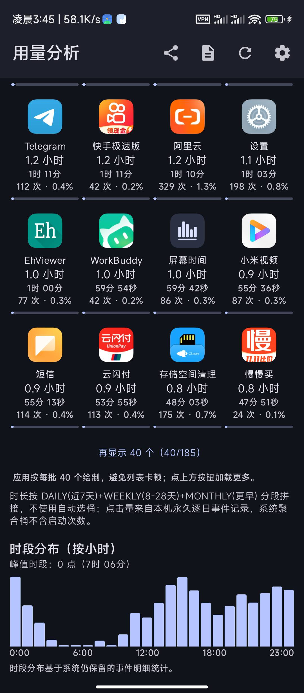
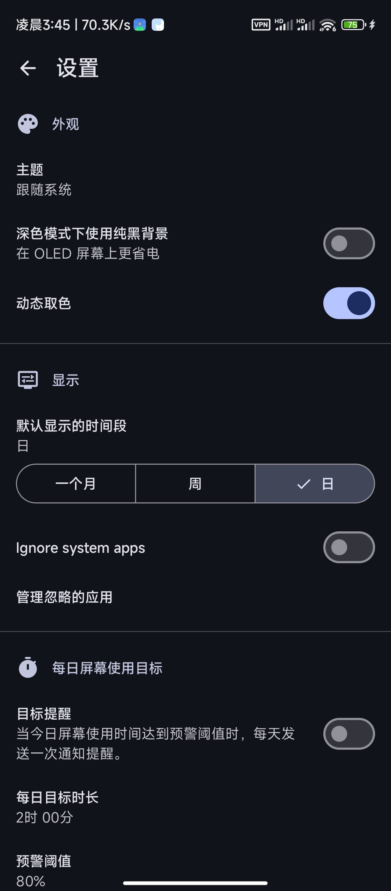
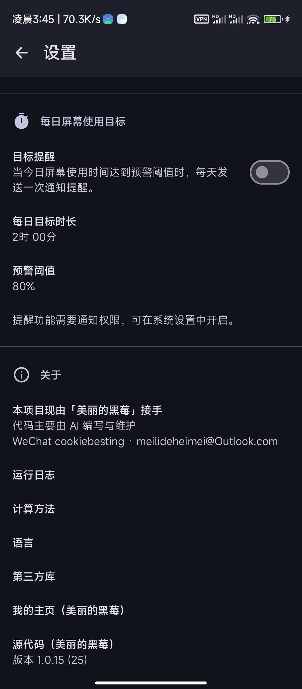

<div align="center"></div>

# <div align="center">Screen Time（화면 사용 시간）</div>

<div align="center">

기기와 앱의 사용 시간, 실행 횟수, 장기 추세를 확인하는 Android 앱.

**유지·주도：아름다운 블랙베리（Beautiful Blackberry）· 코드는 주로 AI 지원으로 작성**

</div>

<div align="center">

[](https://github.com/annbnn183/MyScreenTime/releases)
[](https://www.android.com)
[](https://kotlinlang.org)
[](https://www.gnu.org/licenses/gpl-3.0)
[](.github/workflows/build.yml)

</div>

<div align="center">

[中文](README.md) · [English](README_en.md) · [日本語](README_ja.md) · 한국어 · [繁體中文](README_zh-TW.md)

</div>

---

## 📑 목차

- [이 프로젝트에 대하여](#이-프로젝트에-대하여)
- [✨ 기능](#-기능)
- [📸 스크린샷](#-스크린샷)
- [⬇️ 다운로드](#️-다운로드)
- [💬 연락처](#-연락처)
- [☕ 후원 / 응원](#-후원--응원)
- [🧭 제품 전략 및 로드맵](#-제품-전략-및-로드맵)
- [⚙️ 자동 빌드](#️-자동-빌드)
- [🔐 체크섬](#-체크섬)
- [📄 라이선스](#-라이선스)

---

## 이 프로젝트에 대하여

이 프로젝트는 현재 저（**아름다운 블랙베리**）가 이어받아 유지하고 있습니다. 기능 기획, UX 타협 결정, 각 릴리스까지 제가 주도하며, 실제 코드는 주로 AI 지원으로 작성·반복 개선했습니다. 동일한 설명은 앱 메인 화면과 「설정 → 정보」에도 있습니다.

원본 오픈소스 프로젝트 위에 다음 기능을 차례로 추가했고, 지키는 원칙은 하나입니다：**오픈소스, 광고 없음, 네트워크 접속 없음, 데이터 수집 없음**. UI는 Material 3이며 Kotlin + Jetpack Compose + Vico로 개발했습니다.

---

## ✨ 기능

| 🗓️ 다중 기간 및 장기 추세 | 📊 앱 4열 그리드 순위 |
| :--- | :--- |
| 일 / 주 / 월 보기에 더해 **4주, 반년, 1년(평균)** 장기 추세 보기. 시스템의 사전 집계된 장기 통계를 읽으므로 기록이 더 완전하고 끊김도 없습니다. | 사용 시간 / 실행 횟수 / 이름으로 정렬 가능, 정밀 진행바 및 「40개 더 보기」 증분 로드 지원. |
| 🖱️ 실행 횟수 및 비율 | 🎯 일일 화면 사용 목표 알림 |
| 각 앱의 실행(포그라운드 진입) 횟수와 비율을 집계해 CSV로 출력. | 목표 시간과 경고 비율 사용자 지정. 매일 목표 도달 전에 한 번 알림(Android 13+ 는 알림 권한 필요). |
| 📈 월간 인사이트 | 📤 CSV 내보내기 / 공유 |
| 최장 사용일, 활동 일수, 30일 목표 달력(초록=달성, 빨강=초과). | 상단 툴바에서 현재 기간의 일별 요약과 앱 순위를 원탭으로 내보내기. |
| 🔍 앱별 상세 | 🧩 홈 화면 위젯 |
| 앱별 독립 상세 페이지(비교 차트 포함). | 앱을 열지 않고 홈 화면에서 사용 상황 확인. |

---

## 📸 스크린샷

**v1.0.15** 실기 스크린샷(다크 테마).

| 홈 · 월별 보기 / 월간 개요 | 앱 순위 · 누적 시간 / 4열 그리드 | 앱 순위 · 더 보기 / 시간대 분포 |
| :---: | :---: | :---: |
|  |  |  |

| 설정 · 외관 / 표시 / 일일 목표 | 설정 · 정보 / 실행 로그 / 버전 |
| :---: | :---: |
|  |  |

---

## ⬇️ 다운로드

최신 APK는 [GitHub Releases](https://github.com/annbnn183/MyScreenTime/releases)에서 다운로드하세요.

> **v1.0.7** 부터 모든 빌드는 동일한 고정 서명을 사용하므로, 새 버전은 덮어쓰기로 설치할 수 있습니다. v1.0.4–v1.0.6을 쓰고 계시다면 업그레이드 전에 한 번旧 버전을 제거하세요.

---

## 💬 연락처

기능 요청, 버그 제보, 아이디어, 혹은 그냥 인사도 환영입니다：

| 방법 | 계정 |
| :--- | :--- |
| WeChat | `cookiebesting` |
| 이메일 | [meilideheimei@Outlook.com](mailto:meilideheimei@Outlook.com) |

[Issues](https://github.com/annbnn183/MyScreenTime/issues)에 직접 남길 수도 있습니다. 이 프로젝트가 도움이 된다면 저장소에 ⭐ Star를 눌러주는 것이 큰 힘이 됩니다.

---

## ☕ 후원 / 응원

이 앱이 마음에 드신다면, 계속 유지할 수 있도록 후원(응원)해 주시면 감사하겠습니다. 응원에 감사드립니다.

**받는 사람**：`广州市白云区棠下顺纺商行(cookiebesting)`　·　`#付款:广州市白云区棠下顺纺商行(cookiebesting)`

### WeChat 결제 QR 코드

아래 이미지를 길게 눌러 저장한 뒤, WeChat 「스캔 → 앨범」으로 인식해 결제하세요：

<div align="center">
  
</div>

### 링크를 복사해 WeChat에서 결제하기

아래 링크를 복사해 WeChat에 붙여넣기(「파일 전송」이나 아무 채팅으로 전송)한 뒤 탭하면 결제됩니다：

```
https://payapp.wechatpay.cn/sjt/qr/AQEp0bAiFO50xLIWNTOrUoZE
```

> 위 링크는 QR 코드 본체에서 가져온 WeChat Pay 공식 결제 주소이며, 결제를 시작하려면 **WeChat 내부**에서 열어야 하고 일반 브라우저에서는 결제를 완료할 수 없습니다. 금액은 직접 입력하시면 됩니다. 응원 감사합니다.

---

## 🧭 제품 전략 및 로드맵

> **핵심 포지션**：MyScreenTime은 폰 사용 억제 앱이 아니라, **신뢰할 수 있고 정확하며 장기적이고 개인정보 우선인 개인 디지털 행동 통계 도구**입니다.
> 억제 도구는 사용자 행동을 *바꾸려* 하고, 통계 도구는 사용자가 자신의 행동을 *이해하도록* 돕습니다. 우리는 후자를 제대로 하는 것입니다.

**나의 디지털 타임 장부** —— 기록·집계·비교·분석·내보내기하여, 시간이 진짜 어디로 갔는지 사용자에게 알립니다.

### 5가지 제품 원칙

1. **기능 개수보다 데이터 정확성을 우선한다.**
2. **단기 순위보다 장기 기록을 우선한다.**
3. **클라우드 상업화보다 개인정보를 우선한다.**
4. **사용자가 자신의 데이터를 내보내고 관리할 수 있게 한다.**
5. **사용자 행동을 평가하지 않고 사실만 제시한다.**

### 로드맵(4단계)

| 단계 | 우선순위 | 기간 | 목표 |
| :--- | :---: | :--- | :--- |
| 1 · 기본 신뢰성 | P0 | 1개월차 | 모든 수치를 믿게 한다(정확성; 자정 넘김/시간대/재시작; Android 버전 호환; 권한 및 누락 안내; 계산 방식 공개) |
| 2 · 데이터 분석력 | P1 | 2개월차 | 「얼마나 썼나」에서 「사용 패턴」으로(24시간 분포; 평일/주말 비교; 주/월 전기 대비; 앱별 이력 곡선; 시간 점유율; 평균과 중앙값) |
| 3 · 기록과 주체성 | P2 | 3개월차 | 자신의 데이터를 장기 보관·활용(전체 백업; CSV/JSON 입출력; 사용자 기간; 삭제 및 보관 설정; 무결성 점검) |
| 4 · 경험과 생태계 | 장기 | 4~6개월차 | 언제든 보고, 공유·연구 가능(위젯 개선; 차트 및 정렬 사용자 지정; 앱 분류; 월/연 보고서; 차트 이미지 내보내기; 다국어; F-Droid 검토) |

### 핵심 기능 우선순위

| 우선순위 | 기능 | 제품 가치 |
| :---: | :--- | :--- |
| **P0** | 사용 시간 정확성 | 기반 |
| **P0** | 기록 데이터 완전성 | 장기 가치 |
| **P0** | 앱 실행 횟수 | 차별화 |
| **P0** | CSV / JSON 데이터 관리 | 주체성 |
| **P1** | 24시간 분포 히트맵 | 패턴 발견 |
| **P1** | 주/월 전기 대비 | 변화 발견 |
| **P1** | 앱별 장기 추세 | 심층 분석 |
| **P1** | 앱 분류 통계 | 시간 배분 이해 |
| **P2** | 연간 보고서 | 장기 회고 |
| **P2** | 홈 위젯 | 편의성 |
| **P3** | 다기기 통합 | 확장성 |

### 기술 핵심: 장기와 단기 데이터 분리

Android의 `UsageStatsManager`에는 두 가지 다른 인터페이스가 있습니다：

- `queryUsageStats`：시스템의 **집계된** 앱 사용 통계를 조회(장기 시간에 적합).
- `queryEvents`：앱 사용 **이벤트**를 조회. 공식 문서에 따르면 이벤트 기록은 **며칠만 보관**되며, 반년 전의 모든 실행을 여기서 복원할 수 없습니다.

> 따라서 「일별 집계·장기 보관」 저장 전략을 씁니다. 사용 시간·실행 횟수·시간대 분포는 모두 **매일 집계해 장기 보관**하고, 원시 이벤트는 시스템 기록에 장기 의존하지 않습니다. 앱 정보의 필요한 이력 매핑만 보관합니다. Android가 오래된 이벤트를 지워도 쌓인 기록은 사라지지 않습니다.

**용어 통일**：앱이 포그라운드가 된 것은 화면을 실제로 몇 번 탭했는지와 다르므로, 이 저장소는 「클릭 수 / 클릭률」 대신 「**실행 횟수 / 실행 횟수 비율**」을 통일해 사용합니다.

### 4가지 경쟁 해자

1. **장기 기록** —— 오늘뿐 아니라 1년, 3년, 그 이상 전의 개인 변화도 되돌아볼 수 있음.
2. **데이터 입자도** —— 앱 순위뿐 아니라 시간대 분포, 실행 횟수, 시간 점유율, 기간 비교까지.
3. **데이터 주체성** —— 오프라인 사용, 로컬 보관, 백업, 내보내기, 이전 가능, 플랫폼 종속 없음.
4. **통계 신뢰도** —— 계산 방식을 공개하고 데이터 출처·누락·추정 오차를 설명. 거짓된 정밀함을 만들지 않음.

### 평가 지표(Stars만 보지 않기)

| 지표 | 목적 |
| :--- | :--- |
| 통계 오차율 | 데이터 신뢰 가능성 |
| 30일 연속 데이터 완전율 | 신뢰성 |
| 크래시율 | 안정성 |
| 콜드 스타트 시간 | 사용 경험 |
| 데이터 내보내기 성공률 | 데이터 주체성 |
| 30일 잔존율 | 장기 가치 |
| 피드백 해결율 | 유지 품질 |

> 참고: 30일 잔존율이 높다고 해서 반드시 훌륭한 제품은 아닙니다(가끔 보기만 할 수도). 데이터 완전성·사용 빈도·실제 피드백을 종합해 판단하세요.

### 전략 요약

MyScreenTime은 기능이 가장 많은 화면 사용 시간 앱이 될 필요는 없고, 사용자가 **가장 신뢰하는 화면 사용 시간 데이터 기록 도구**가 되는 것입니다.

> **사실을 기록하고, 기록을 축적하고, 패턴을 분석하고, 데이터의 해석권을 사용자에게 돌려줍니다.**

<details>
<summary>📋 로드맵 상세 체크리스트(클릭하여 펼치기)</summary>

**단계 1 · 기본 신뢰성(P0)**
- [ ] 화면 사용 시간 통계 정확성 점검
- [ ] 자정 넘김·시간대 변경·재시작 후 데이터 점검
- [ ] 여러 Android 버전 호환성 검증
- [ ] 앱 실행 횟수 통계 점검
- [ ] 데이터 누락·권한 꺼짐 안내 제공
- [ ] 각 통계의 계산 방식 명확화

**단계 2 · 데이터 분석력(P1)**
- [ ] 24시간 사용 분포 차트
- [ ] 평일과 주말 비교
- [ ] 이번 주와 지난주 비교
- [ ] 이번 달과 지난달 비교
- [ ] 앱별 이력 변화 곡선
- [ ] 앱 사용 시간의 전체 점유율
- [ ] 일일 평균 사용 시간과 중앙값

**단계 3 · 기록과 주체성(P2)**
- [ ] 전체 기록 데이터 백업
- [ ] CSV 입출력
- [ ] JSON 백업 및 복원
- [ ] 사용자 지정 기간 조회
- [ ] 데이터 삭제 및 로그 보관 설정
- [ ] 통계 데이터 무결성 점검

**단계 4 · 경험과 생태계(장기)**
- [ ] 홈 위젯 개선
- [ ] 사용자 지정 차트 및 정렬
- [ ] 앱 분류 통계
- [ ] 월간/연간 보고서
- [ ] 차트 이미지 내보내기
- [ ] 다국어 보완
- [ ] F-Droid 게시 타당성 평가

**당분간 투자하지 않음**(비용만 늘리고 핵심 가치를 높이지 않을 수 있는 것): AI 채팅 비서, 소셜 순위, 강제 앱 잠금, 복잡한 구독, 클라우드 계정 체계, 통계와 무관한 다수 기능.

**차별화 참고(경쟁사)**
- *Android 디지털 웰빙*: 시스템 통합, 권한 흐름 성숙. 약점은 제조사 구현과 기록 분석 경험의 편차 → 우리의 기회는 장기 통계와 내보내기.
- *Screen Time*: 광고 없음, 수집 없음, 시간 차트와 위젯 → 장기 추세, 실행 횟수, 심층 분석 강화.
- *Lumen*: 기능 풍부 → 폭보다는 통계 경험의 전문화를 지향.

</details>

---

## ⚙️ 자동 빌드

`main`에 푸시하면 [`.github/workflows/build.yml`](.github/workflows/build.yml)이 실행되어 `assembleDefaultDebug`를 빌드, 고정 키로 서명해 APK를 Releases에 게시합니다. **버전 번호는 [`app/build.gradle.kts`](app/build.gradle.kts)의 `versionName`을 유일한 진짜 소스**로 합니다. Release 태그·Release 이름·APK 파일명(예 `MyScreenTime-v1.0.15.apk`)·설정 → 정보에 표시되는 버전은 모두 여기서 생성되므로 항상 일치합니다. 새 버전 게시 시 `versionName`과 `versionCode`를 함께 올리기만 하면 됩니다. 서명 키는 저장소의 Actions Secrets에만 있고 커밋되지 않습니다(`.gitignore` 참조).

---

## 🔐 체크섬

배포된 APK의 진위와 무결성을 확인하려면 서명 인증서 지문을 아래 값과 대조하세요.

```
SHA-256: d075b5e1611b318d9e2f11e62d2bfebe0afbed51c17f935ba701d233d3fef501
SHA-1: 57839e6c38b7821da9c9c80767e7cedf9d8b5eab
MD5: bf656b4b431a1a688a9b2fa69b430e9e
```

인증서 주체: `CN=MyScreenTime, OU=OpenSource, O=MyScreenTime, L=Beijing, ST=Beijing, C=CN`. 이 저장소에서 배포되는 모든 APK는 동일한 고정 키로 서명되므로, 서명이 일치하면 이전 버전을 삭제하지 않고 덮어설치할 수 있습니다.

---

## 📄 라이선스

코드는 [GNU General Public License v3 or later (GPL-3.0-or-later)](https://www.gnu.org/licenses/gpl-3.0)를 따릅니다.

종속 라이브러리 라이선스：

- [Core KTX](https://github.com/androidx/androidx) is licensed under [Apache License 2.0](https://www.apache.org/licenses/LICENSE-2.0)
- [Activity Compose](https://github.com/androidx/androidx) is licensed under [Apache License 2.0](https://www.apache.org/licenses/LICENSE-2.0)
- [Compose BOM](https://github.com/androidx/androidx) is licensed under [Apache License 2.0](https://www.apache.org/licenses/LICENSE-2.0)
- [Compose UI](https://github.com/androidx/androidx) is licensed under [Apache License 2.0](https://www.apache.org/licenses/LICENSE-2.0)
- [Compose UI Graphics](https://github.com/androidx/androidx) is licensed under [Apache License 2.0](https://www.apache.org/licenses/LICENSE-2.0)
- [Compose Material 3](https://github.com/androidx/androidx) is licensed under [Apache License 2.0](https://www.apache.org/licenses/LICENSE-2.0)
- [Compose Material Icons Extended](https://github.com/androidx/androidx) is licensed under [Apache License 2.0](https://www.apache.org/licenses/LICENSE-2.0)
- [Lifecycle Runtime Compose](https://github.com/androidx/androidx) is licensed under [Apache License 2.0](https://www.apache.org/licenses/LICENSE-2.0)
- [Navigation Compose](https://github.com/androidx/androidx) is licensed under [Apache License 2.0](https://www.apache.org/licenses/LICENSE-2.0)
- [DataStore Preferences](https://github.com/androidx/androidx) is licensed under [Apache License 2.0](https://www.apache.org/licenses/LICENSE-2.0)
- [Koin AndroidX Compose](https://github.com/InsertKoinIO/koin) is licensed under [Apache License 2.0](https://www.apache.org/licenses/LICENSE-2.0)
- [Vico](https://github.com/patrykandpatrick/vico) is licensed under [Apache License 2.0](https://www.apache.org/licenses/LICENSE-2.0)
- [Kotlin Serialization](https://github.com/Kotlin/kotlinx.serialization) is licensed under [Apache License 2.0](https://www.apache.org/licenses/LICENSE-2.0)

---

<div align="center">Screen Time · 아름다운 블랙베리</div>
