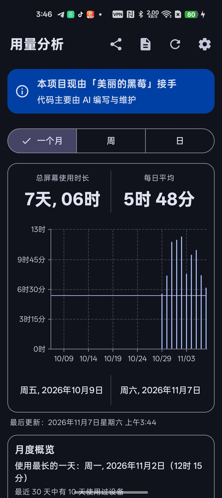
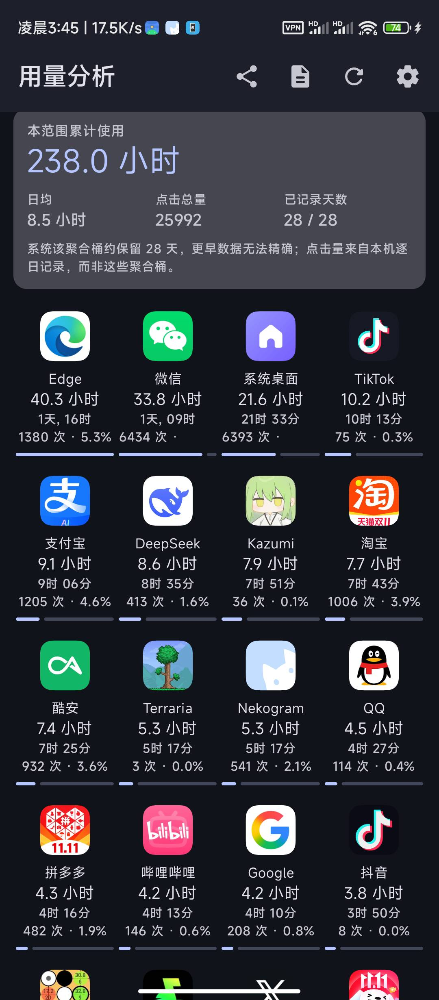
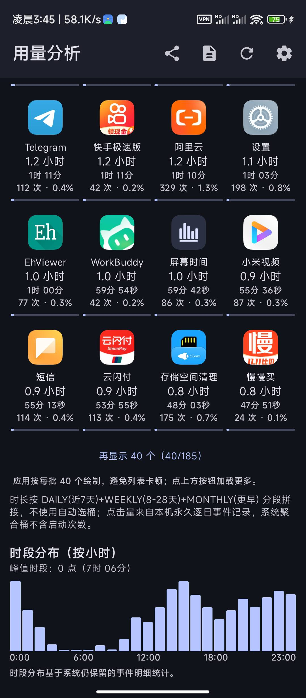
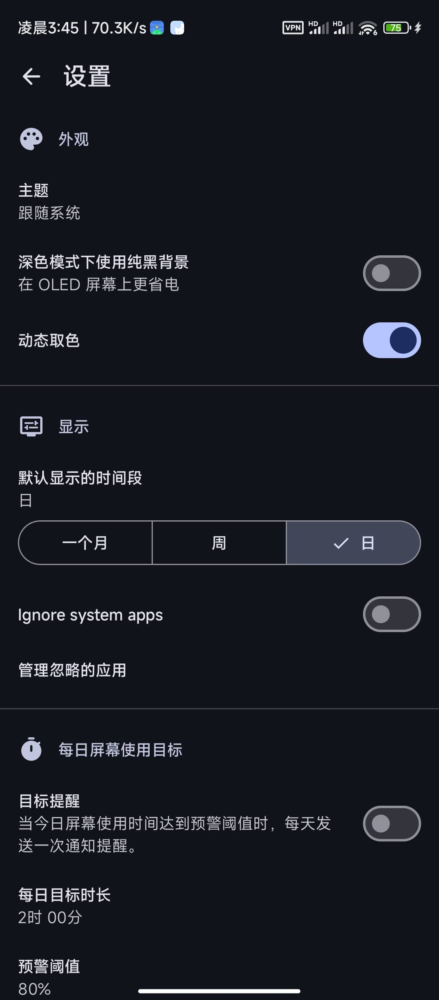
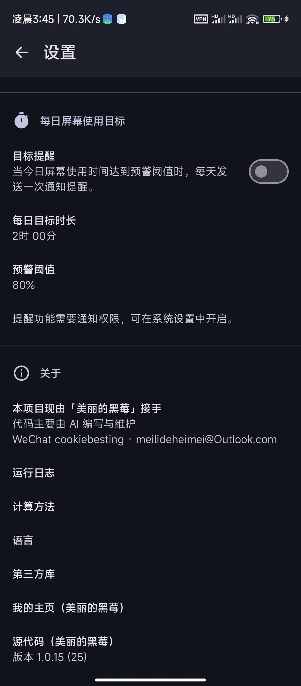

<div align="center"></div>

# <div align="center">Screen Time · 螢幕使用時間</div>

<div align="center">

一款檢視裝置與應用程式使用時長、開啟次數與長期趨勢的 Android 應用程式。

**由 美麗的黑莓 接手並主導維護 · 程式碼主要由 AI 輔助編寫**

</div>

<div align="center">

[](https://github.com/annbnn183/MyScreenTime/releases)
[](https://www.android.com)
[](https://kotlinlang.org)
[](https://www.gnu.org/licenses/gpl-3.0)
[](.github/workflows/build.yml)

</div>

<div align="center">

[中文](README.md) · [English](README_en.md) · [日本語](README_ja.md) · [한국어](README_ko.md) · 繁體中文

</div>

---

## ✅ 目前版本：v1.0.29（統計頁面左右滑動切換週期）

v1.0.29 將統計畫面改為「年 / 月 / 週 / 日」四個橫向頁面。在統計內容區域輕輕左右滑動，即可切換相鄰週期，並以原生頁面滑動與吸附動畫平順切換。週期選擇按鈕會與目前頁面同步，原有直接點選功能也保留。「統計概覽 / 應用程式排行」之間的上下滑動同樣保留。

本次只調整畫面導覽，不修改統計資料來源、計算邏輯、歷史資料、資料庫結構或備份格式。沿用原有套件 ID 與固定簽章，GitHub Actions 會在發布前驗證憑證指紋。

## 🆕 v1.0.29：統計內容區域支援左右輕掃

- **整個內容區都能滑動：** 在統計概覽或應用程式排行頁面左右輕掃，都能切換相鄰週期。
- **平順頁面動畫：** 使用橫向分頁與吸附效果，放手後完整停靠，不會停在兩頁中間。
- **輕量且可控：** 較短的滑動即可切換，每次最多移動一個週期，避免一次跳過多個週期。
- **選擇欄同步：** 年 / 月 / 週 / 日按鈕會跟隨目前頁面，仍可直接點選跳轉。
- **保留縱向導覽：** 上下滑動仍可切換統計概覽與應用程式排行。
- **資料安全：** 不修改統計邏輯、歷史紀錄、資料庫結構、備份格式或使用者資料。

## 🆕 v1.0.24：雙頁縱向輕掃體驗

- **首頁改為雙頁章節：** 第一頁集中顯示週期選擇、總使用時長與週期比較；第二頁顯示月度洞察與應用程式排行。
- **輕掃即可切換：** 降低翻頁觸發門檻，讓短距離上下滑動更容易切換頁面。
- **放手後自動吸附：** 頁面會完整停靠，不會停在半頁；單次手勢最多切換一頁。
- **保留原有功能：** 週期統計、應用程式排行、匯出、日誌、重新整理、設定與應用程式詳情入口均保留。
- **升級相容：** v1.0.24 保留原有套件 ID 與固定簽章，可直接覆蓋安裝 v1.0.7 及之後的版本；不變更資料庫結構、備份格式或使用者資料。

## 🧪 v1.0.22：讓診斷摘要真正幫助下一版開發

這次不是增加日誌數量，而是讓匯出的內容更準確、更容易定位問題：

- **限定最近 24 小時**：不再把歷史累積的點擊、掉幀和查詢耗時混入目前數據，並明確列出起訖時間。
- **故障優先**：突出 ERROR/FATAL、主執行緒阻塞/ANR，以及系統記錄的異常結束。
- **性能可定位**：統計點擊到首幀、互動期間掉幀、監控中斷間隔和查詢耗時。
- **提供記憶體依據**：顯示 PSS 平均/峰值、Heap 峰值、系統可用記憶體最低值和取樣次數。
- **保留頁面線索**：最慢的點擊和查詢附上時間及頁面名稱，協助決定下一版先修哪裡。
- **不刪除原始日誌**：只調整摘要分析與匯出說明；本機完整日誌仍保留，也能匯出最近 500 行或完整歷史。

注意：Android 可能在應用程式下次啟動時，才回報更早之前的程序結束原因。報告會特別註明，避免把舊版本的異常誤判為新版問題。

## 🛠 v1.0.21：效能與直接升級相容性

- **降低記憶體使用：** 日／週／月結果不再為所有應用程式長期保留完整 Drawable；圖示改為需要時才載入，並共用有容量上限的縮小版 LRU 快取。應用程式詳細頁標題圖示也改為延遲載入。
- **改善掉幀判讀：** 背景或閒置期間 Choreographer 可能暫停回呼；超過 10 秒且沒有近期互動的長間隔改記為 `FRAME_MONITOR_GAP`，不再誤判為 `JANK`。
- **可直接覆蓋安裝：** 使用不可偵錯、已最佳化的 Release APK，同時刻意保留 `com.atharok.screentime.debug` 套件 ID，以相容目前安裝的 v1.0.20。
- **簽章防護：** GitHub Actions 發佈前會驗證套件 ID、版本與固定憑證 SHA-256；若缺少固定金鑰，建置會直接失敗，不會退回臨時 Debug 簽章。
- 不變更資料庫結構、備份格式或使用者資料。

## 📑 目錄

- [關於這個專案](#關於這個專案)
- [✨ 功能特性](#-功能特性)
- [📸 介面截圖](#-介面截圖)
- [⬇️ 下載](#️-下載)
- [💬 聯絡我](#-聯絡我)
- [☕ 打賞 / 支持我](#-打賞--支持我)
- [🧭 產品戰略與發展路線](#-產品戰略與發展路線)
- [⚙️ 自動建置](#️-自動建置)
- [🔐 校驗和](#-校驗和)
- [📄 授權](#-授權)

---

## 關於這個專案

這個專案現在由我（**美麗的黑莓**）接手。從功能規劃、互動取捨到每個版本的發布，都由我推進；具體程式碼主要借助 AI 編寫與迭代。應用程式內的主介面與「設定 → 關於」裡也放了同樣的說明。

在原開源專案的基礎上，我陸續補上了這些能力，並堅持一條原則：**開源、無廣告、不聯網、不蒐集資料**。介面為 Material 3，使用 Kotlin + Jetpack Compose + Vico 開發。

---

## ✨ 功能特性

| 🗓️ 多週期與長期趨勢 | 📊 應用程式四列網格排行 |
| :--- | :--- |
| 日 / 週 / 月多週期檢視，以及 **4 週、半年、一年（平均）** 的長期趨勢檢視：讀取系統預聚合的長週期統計，歷史更完整，也不卡頓。 | 可按使用時長 / 開啟次數 / 名稱 / **綜合**排序，附細進度條，支援「再顯示 40 個」增量載入。 |
| 🖱️ 開啟次數與占比 | 🎯 每日螢幕使用目標提醒 |
| 統計各應用程式的開啟（進入前景）次數及占比，並寫入 CSV 報表。 | 自訂目標時長與預警比例，每天在達標前提醒一次（Android 13+ 需通知權限）。 |
| 📈 月度洞察 | 📤 CSV 匯出 / 分享 |
| 最長使用日、活躍天數，以及 30 天目標日曆（綠 = 達標，紅 = 超標）。 | 從頂部工具列一鍵匯出目前週期的每日摘要與應用程式排行。 |
| 🔍 單一應用程式詳情 | 🧩 主畫面小工具 |
| 每個應用程式獨立詳情頁，含對比圖表。 | 無需開啟應用程式即可在桌面檢視使用情況。 |

---

## 💾 資料管理：備份、還原與移轉

> 你累積了一年的資料，比剛安裝時更有價值。本次更新聚焦於讓資料**能被完整備份、安全還原，並在換手機時移轉過去**。

**會備份哪些資料：** 全部設定（主題、預設時間段、忽略應用清單、每日目標、自動備份開關等）與**逐日、逐應用的開啟次數永久紀錄**。

**不會（也無法）備份的資料：** 使用**時長**與小時分布來自 Android 的 `UsageStatsManager`，是**裝置本身的系統資料**，任何應用都無法將它匯出並寫入另一支手機。本應用**如實**只備份自己持有的資料，絕不偽造「時長備份」。移轉後，新裝置從授權當天起重新累積時長。

**備份**
- 具版本號、匯出時間、時區、筆數與 SHA-256 校驗和的 JSON。
- 寫入後立即讀回比對，**只有一致才提示成功**（不一致提示「校驗失敗」）。
- 可選密碼加密（AES-256-GCM + PBKDF2，隨機 salt/IV）。**密碼一旦忘記，資料無法找回。**
- 儲存位置由你決定（內部儲存、下載、SD 卡、Google Drive 等），請勿只留在應用私有目錄（解除安裝會被刪除）。

**還原（安全優先）**
1. 校驗：非空、≤32MB、合法 JSON、版本可辨識、校驗和與筆數一致。
2. 目前資料的安全快照（記憶體＋私有檔案）與「還原進行中」標記。
3. 選擇**合併（保留現有）**（歷史按逐日逐應用取較大值併入，重複匯入不會翻倍）或**覆蓋（取代現有）**。
4. 還原後再次核對筆數。
5. 任何失敗都**自動回滾**到快照，絕不留「只還原一半」的狀態。
6. 崩潰安全：還原途中被強制關閉或斷電，下次啟動會偵測標記並自動回滾。

**換手機移轉步驟：** 舊手機 → 備份（可加密）到可拷走的位置 → 新手機安裝同簽名版本 → 還原 → 選擇合併或覆蓋 → 依提示重新授予「使用情況存取」權限（此系統特殊權限無法隨檔案移轉）。

**自動本機備份：** 每天一份，只保留最近 7 份，存於應用私有外部目錄（解除安裝即刪除，移轉請手動匯出）。

**刪除全部資料：** 先留一份安全快照，再清空設定與歷史。

**版本相容：** 備份格式與資料庫結構相互獨立，檔案帶 `format`/`schemaVersion`；**較新格式的備份會被拒絕並說明原因**，較舊格式會被處理。

---

## 🗂 v1.0.20：日誌短到能貼進聊天框

以前按「分享」只有一種結果：一個 1.6 MB、9000 行的 TXT。微信傳不出去，貼進 AI 對話框也太長，最後只能刪掉大半——真正有用的錯誤行反而沒了。

這一版把「匯出」拆成三檔，由你選：

| 粒度 | 體積 | 適用場景 |
| :--- | :--- | :--- |
| 精簡摘要 | 約 600 字 | 直接貼進微信 / ChatGPT，一屏看完 |
| 最近 500 行 | 約 60 KB | 需要上下文，但不想給整份歷史 |
| 完整日誌 | 幾 MB | 存檔、逐行核對 |

頂端的複製按鈕現在複製的是**精簡摘要**，只包含：

- 版本、套件名、裝置型號、Android 版本、ABI、使用情況存取權限
- 錯誤筆數（ERROR / FATAL / 崩潰 / ANR），以及最近幾筆原文
- 異常結束（低記憶體被殺、ANR、崩潰），依原因去重
- 關鍵指標：點擊到首幀（平均／最差）、掉幀、查詢耗時（平均／最差）
- 最慢的 3 次點擊與 2 次查詢

摘要上限 1500 字。萬一超出，先丟「最慢操作」，再丟「關鍵指標」，**錯誤與裝置資訊永不丟**。

> 順帶修了一個會讓統計徹底失真的問題：系統每次啟動都會把同一批結束記錄再回傳一遍，應用原樣寫進日誌，於是一次被殺會記 8 次——舊日誌裡「109 次 LOW_MEMORY」其實只發生 13 次。現在依「原因 + 時間」去重，新記錄不再重複，歷史重複項在摘要裡也會合併。

日誌策略沒變：**完整日誌仍然一筆不丟、永久保存**。這一版只是多給了幾種更短的匯出方式，不刪除任何東西。

---

## 🏆 v1.0.19：綜合排行榜

排行榜原本只能「按時長」或「按點擊量」二選一，用得久但很少開啟的應用，和開得勤但每次很短的應用，沒辦法放在一起比。這一版在排序選單新增第 4 項 **「綜合」**，把兩個維度合成一個榜。

| 項目 | 說明 |
| :--- | :--- |
| 演算法 | 綜合佔比 = 時長佔比 × w + 點擊佔比 × (1 − w)。兩個佔比都相對於所選範圍內所有應用的總量，所以各應用的綜合佔比加起來是 100% |
| 為什麼用佔比 | 毫秒和次數單位不同，直接相加會被數值大的一項壓倒；佔比都落在 0–1，才能公平加權 |
| 三檔權重 | 時長優先 7:3 / 均衡 5:5（預設）/ 點擊優先 3:7，一鍵切換 |
| 範圍 | 跟隨上方「4 週 / 半年 / 一年」；日、週檢視使用目前週期的資料 |
| 每列顯示 | 名次、圖示、應用名稱、時長及佔比、點擊次數及佔比、綜合佔比 |
| 沒有點擊量記錄時 | 自動只按時長排序並給出提示，不會用一個全為 0 的權重來排名 |
| 同分 | 依序按時長、名稱決定，確保順序穩定 |
| 首屏 | 前 10 名，其餘按需展開 |

順帶修了一個小問題：「再顯示」按鈕原本只在應用多於 40 個時出現，21–40 個應用時展開不了；現在按首屏數量判斷，「只看前 40 個」也改成「收起」。

> 注意：點擊量只涵蓋摘要卡裡的「已記錄天數」，而時長涵蓋整個範圍。已記錄天數遠少於範圍天數時，兩項的統計視窗不一致，綜合榜僅供參考。

## ⚡ v1.0.17 → v1.0.18：依真實執行日誌修正

每一項都來自使用者匯出的執行日誌，改完再用新日誌驗收。

| 日誌中的現象 | 根因 | 改法 | 出貨後實測 |
| :--- | :--- | :--- | :--- |
| 首幀掉幀 **971 ms** | 建構子裡用 `runBlocking` 讀 DataStore，阻塞主執行緒 | 先以預設週期繪製，設定改非同步讀取 | 不再出現 `MAIN_THREAD_BLOCKED` |
| 結果上屏時 **904 ms** 長幀 | 首屏一次組合 40 個應用格＋卡片＋圖表 | 首屏 20 個（剛好一屏），其餘按需展開 | 點擊到首幀最差 **397 ms → 76 ms**，平均 14 → 10 ms |
| 「補算」要手動點 **10 次以上** | 每次只推進 31 天，且每次重掃 10 天事件 | 一次補滿 365 天＋進度，完成後只重建快取 | `stored days: 366`，之後 `Backfilled 0 days`，全自動 |
| PSS 峰值 **1.36 GB**，行程被系統殺掉 | 逐日重寫整個 JSON | 每 8 天批次寫入，超出事件窗口的日期直接標記 | PSS 峰值 **1375 MB → 303 MB**，不再被 `LOW_MEMORY` 殺 |

### v1.0.18：讓日誌說真話

| 發現 | 為何必須修 | 本版做法 |
| :--- | :--- | :--- |
| 922 筆 `JANK` 絕大多數是**誤報** | 把「介面靜止、本來就沒有新幀」也算成掉幀，出現 2.3 秒的「掉幀」，但同時點擊只要 10 ms | 只有最近 1.2 秒內有觸碰才算真掉幀；靜止期改記為 `IDLE_GAP`，分開統計 |
| 靜止期日誌刷屏 | 空閒時每秒都可能記一筆，一天 1.7 MB，匯出也變慢 | `IDLE_GAP` 每 30 秒彙總一筆，記錄該區間最長無幀間隔 |
| 摘要 `jank=922` 無法判斷體驗 | 真假混在一起 | 摘要新增 `Idle gaps` 一行；分析提示改為**優先看 `CLICK_TO_FRAME`** |
| 補算 0 天仍重建整屏 | 資料沒變，卻卡了 **627 ms** | 結果為 0 直接返回 |

> 日誌政策不變：仍然一筆不丟、永久保存。「不把靜止期算成掉幀」不是刪日誌，而是不再把沒發生的事記成掉幀。

## 📸 介面截圖

以下為 **v1.0.15** 實機截圖（深色主題）。

| 主介面 · 月檢視 / 月度概覽 | 應用程式排行 · 累計時長 / 四列網格 | 應用程式排行 · 載入更多 / 時段分布 |
| :---: | :---: | :---: |
|  |  |  |

| 設定 · 外觀 / 顯示 / 每日目標 | 設定 · 關於 / 執行日誌 / 版本 |
| :---: | :---: |
|  |  |

---

## ⬇️ 下載

到 [GitHub Releases](https://github.com/annbnn183/MyScreenTime/releases) 下載最新 APK。

> 從 **v1.0.7** 起，所有建置使用同一份固定簽名，新版本可以直接覆蓋安裝。如果你還在用 v1.0.4–v1.0.6，升級前請先解除安裝一次舊版本。

---

## 💬 聯絡我

提需求、報 bug、聊想法，或者只是想認識一下，都歡迎：

| 方式 | 帳號 |
| :--- | :--- |
| 微信 | `cookiebesting` |
| 信箱 | [meilideheimei@Outlook.com](mailto:meilideheimei@Outlook.com) |

也可以直接在 [Issues](https://github.com/annbnn183/MyScreenTime/issues) 裡留言。如果覺得這個專案有用，給倉庫點個 ⭐ Star 就是對我最大的支持。

---

## ☕ 打賞 / 支持我

如果你喜歡這個軟體，可以給我打賞，支持我繼續把它維護下去，謝謝你的鼓勵。

**付款**：`廣州市白雲區棠下順紡商行(cookiebesting)`　·　`#付款:廣州市白雲區棠下順紡商行(cookiebesting)`

### 微信收款碼

長按儲存下圖，用微信「掃一掃 → 相簿」辨識即可付款：

<div align="center">
  
</div>

### 複製到微信即可付款

複製下面這條連結，貼到微信裡（發給「檔案傳輸助手」或任意聊天視窗），點開即可付款：

```
https://payapp.wechatpay.cn/sjt/qr/AQEp0bAiFO50xLIWNTOrUoZE
```

> 上面的連結來自收款碼本身，是微信支付的官方收款地址；需要在**微信內**開啟才能發起付款，普通瀏覽器裡無法完成支付。金額由你自行填寫，謝謝支持。

---

## 🧭 產品戰略與發展路線

> **核心定位**：MyScreenTime 不是一個手機防沉迷軟體，而是一個**可靠、準確、長期、隱私優先的個人數位行為統計工具**。
> 防沉迷工具試圖*改變*使用者的行為；統計工具幫助使用者*理解*自己的行為。我們優先把第二件事做好。

**我的數位時間帳本** —— 記錄、統計、比較、分析、匯出，讓使用者知道自己的時間究竟去了哪裡。

### 五條產品原則

1. **資料準確性優先於功能數量。**
2. **長期歷史優先於短期排行榜。**
3. **隱私優先於雲端商業化。**
4. **使用者能夠匯出並掌控自己的資料。**
5. **不評價使用者的行為，只呈現事實。**

### 路線圖（四階段）

| 階段 | 優先級 | 週期 | 目標 |
| :--- | :---: | :--- | :--- |
| 一 · 基礎可靠性 | P0 | 第 1 個月 | 讓使用者相信每一項資料（準確性、跨午夜/時區/重啟、Android 版本相容、權限與缺失提示、公開計算口徑） |
| 二 · 資料分析能力 | P1 | 第 2 個月 | 從「用了多久」升級為「使用規律」（24h 分布、工作日/週末對比、週/月同比、單應用歷史曲線、時間占比、均值與中位數） |
| 三 · 歷史資料與自主權 | P2 | 第 3 個月 | 長期保存與使用自己的資料（完整備份、CSV/JSON 匯入匯出、自訂區間、清理與保留設定、完整性檢查） |
| 四 · 體驗與生態 | 長期 | 第 4–6 個月 | 隨時可看、可分享、可研究（小工具優化、自訂圖表排序、應用分類、月/年度報告、圖表圖片匯出、多語言、F-Droid 評估） |

### 核心功能優先級

| 優先級 | 功能 | 產品價值 |
| :---: | :--- | :--- |
| **P0** | 使用時長準確性 | 產品根基 |
| **P0** | 歷史資料完整性 | 長期價值 |
| **P0** | 應用程式開啟次數 | 差異化 |
| **P0** | CSV / JSON 資料管理 | 自主權 |
| **P1** | 24 小時分布熱力圖 | 發現使用規律 |
| **P1** | 週同比 / 月同比 | 發現變化 |
| **P1** | 單應用程式長期趨勢 | 深度分析 |
| **P1** | 應用程式分類統計 | 理解時間分配 |
| **P2** | 年度報告 | 長期回顧 |
| **P2** | 主畫面小工具 | 便利性 |
| **P3** | 多裝置資料合併 | 擴充能力 |

### 關鍵技術點：長期與短期資料分離

Android 的 `UsageStatsManager` 有兩個不同介面：

- `queryUsageStats`：查詢系統**聚合**的應用程式使用統計（適合長期時長）。
- `queryEvents`：查詢應用程式使用**事件**；官方文件明確事件記錄**只保留幾天**，不能據此還原半年前的每一次開啟。

> 因此採用「按日摘要、長期保存」的儲存策略：使用時長、開啟次數、小時分布都做**每日摘要後長期保存**；原始事件不長期依賴系統記錄；應用程式資訊保存必要的歷史對應。即使 Android 清理了舊事件，已累積的歷史統計也不會消失。

**術語統一**：應用程式進入前景事件並不等於使用者實際點擊了多少次螢幕，故本倉庫統一使用「**開啟次數**」與「**開啟次數占比**」，不再使用「點擊量 / 點擊率」。

### 四大競爭壁壘

1. **長期歷史** —— 不只能看今天，還能回顧過去一年、三年甚至更久的個人使用變化。
2. **資料顆粒度** —— 不只有應用程式排行，還能看到小時分布、開啟次數、時間占比和週期對比。
3. **資料自主權** —— 離線使用、本機保存、可備份、可匯出、可遷移，不被平台鎖定。
4. **統計可信度** —— 公開統計口徑，說明資料來源、缺失情況和估算誤差，不製造虛假的精確感。

### 衡量指標（不只看 Stars）

| 指標 | 衡量目的 |
| :--- | :--- |
| 統計誤差率 | 資料是否可信 |
| 連續 30 天資料完整率 | 是否可靠 |
| 崩潰率 | 穩定性 |
| 冷啟動耗時 | 使用體驗 |
| 資料匯出成功率 | 資料自主權 |
| 30 天留存率 | 長期價值 |
| 使用者回饋解決率 | 維護品質 |

> 注意：30 天留存率高不一定代表產品優秀（使用者可能只是偶爾檢視），需結合資料完整性、使用頻率與實際回饋綜合判斷。

### 戰略總結

MyScreenTime 不需要成為功能最多的螢幕使用時間軟體，而應該成為使用者**最信任的螢幕使用時間資料記錄工具**。

> **記錄事實，累積歷史，分析規律，把資料的解釋權交還給使用者。**

<details>
<summary>📋 路線圖詳細清單（點擊展開）</summary>

**階段一 · 基礎可靠性（P0）**
- [ ] 檢查螢幕使用時長統計準確性
- [ ] 檢查跨午夜、時區變化、重啟後的資料
- [ ] 驗證不同 Android 版本的資料相容性
- [ ] 檢查應用程式開啟次數統計
- [ ] 提供資料缺失、權限關閉的提示
- [ ] 明確每種統計的計算口徑

**階段二 · 資料分析能力（P1）**
- [ ] 24 小時使用時間分布圖
- [ ] 工作日與週末對比
- [ ] 本週與上週對比
- [ ] 本月與上月對比
- [ ] 每個應用程式的歷史變化曲線
- [ ] 應用程式使用時間佔總時間的比例
- [ ] 每日平均使用時長與中位數

**階段三 · 歷史資料與自主權（P2）**
- [ ] 完整歷史資料備份
- [ ] CSV 匯入與匯出
- [ ] JSON 備份與還原
- [ ] 自訂日期範圍查詢
- [ ] 資料清理與日誌保留設定
- [ ] 統計資料完整性檢查

**階段四 · 體驗與生態（長期）**
- [ ] 主畫面小工具優化
- [ ] 自訂圖表和排序
- [ ] 應用程式分類統計
- [ ] 月度、年度報告
- [ ] 圖表圖片匯出
- [ ] 多語言完善
- [ ] F-Droid 發布可行性評估

**暫不投入**（可能增加成本卻不一定提高核心價值）：AI 聊天助手、社交排行榜、強制鎖定應用程式、複雜會員訂閱、雲端帳戶體系、大量與統計無關的功能。

**差異化參考（競品）**
- *Android 數位健康*：系統整合、權限鏈路成熟；不足是廠商實作與歷史分析體驗不一 → 我們的機會在長週期統計與匯出。
- *Screen Time*：無廣告、無蒐集、小時圖表與主畫面小工具 → 我們強化長期趨勢、開啟次數與深度分析。
- *Lumen*：功能豐富 → 我們不求大而全，把統計體驗做到專業。

</details>

---

## ⚙️ 自動建置

推送到 `main` 會觸發 [`.github/workflows/build.yml`](.github/workflows/build.yml)，建置 `assembleDefaultRelease`，用固定金鑰簽名後把 APK 發佈到 Releases。**版本號以 [`app/build.gradle.kts`](app/build.gradle.kts) 的 `versionName` 為唯一來源**：Release 標籤、Release 名稱、APK 檔名（如 `MyScreenTime-v1.0.22.apk`）以及應用程式內「設定 → 關於」顯示的版本都由它生成，因此始終一致；發佈新版本只需同時遞增 `versionName` 與 `versionCode`。簽名金鑰只存放在倉庫的 Actions Secrets 中，不入庫（見 `.gitignore`）。

---

## 🔐 校驗和

為驗證發佈 APK 的真實性與完整性，可將其簽名憑證指紋與下方對照：

```
SHA-256: d075b5e1611b318d9e2f11e62d2bfebe0afbed51c17f935ba701d233d3fef501
SHA-1: 57839e6c38b7821da9c9c80767e7cedf9d8b5eab
MD5: bf656b4b431a1a688a9b2fa69b430e9e
```

憑證主體：`CN=MyScreenTime, OU=OpenSource, O=MyScreenTime, L=Beijing, ST=Beijing, C=CN`。本倉庫所有發佈的 APK 均使用同一固定金鑰簽名，簽名一致即可直接覆蓋安裝、無須解除安裝舊版。

---

## 📄 授權

程式碼沿用 [GNU General Public License v3 or later (GPL-3.0-or-later)](https://www.gnu.org/licenses/gpl-3.0)。

依賴授權：

- [Core KTX](https://github.com/androidx/androidx) is licensed under [Apache License 2.0](https://www.apache.org/licenses/LICENSE-2.0)
- [Activity Compose](https://github.com/androidx/androidx) is licensed under [Apache License 2.0](https://www.apache.org/licenses/LICENSE-2.0)
- [Compose BOM](https://github.com/androidx/androidx) is licensed under [Apache License 2.0](https://www.apache.org/licenses/LICENSE-2.0)
- [Compose UI](https://github.com/androidx/androidx) is licensed under [Apache License 2.0](https://www.apache.org/licenses/LICENSE-2.0)
- [Compose UI Graphics](https://github.com/androidx/androidx) is licensed under [Apache License 2.0](https://www.apache.org/licenses/LICENSE-2.0)
- [Compose Material 3](https://github.com/androidx/androidx) is licensed under [Apache License 2.0](https://www.apache.org/licenses/LICENSE-2.0)
- [Compose Material Icons Extended](https://github.com/androidx/androidx) is licensed under [Apache License 2.0](https://www.apache.org/licenses/LICENSE-2.0)
- [Lifecycle Runtime Compose](https://github.com/androidx/androidx) is licensed under [Apache License 2.0](https://www.apache.org/licenses/LICENSE-2.0)
- [Navigation Compose](https://github.com/androidx/androidx) is licensed under [Apache License 2.0](https://www.apache.org/licenses/LICENSE-2.0)
- [DataStore Preferences](https://github.com/androidx/androidx) is licensed under [Apache License 2.0](https://www.apache.org/licenses/LICENSE-2.0)
- [Koin AndroidX Compose](https://github.com/InsertKoinIO/koin) is licensed under [Apache License 2.0](https://www.apache.org/licenses/LICENSE-2.0)
- [Vico](https://github.com/patrykandpatrick/vico) is licensed under [Apache License 2.0](https://www.apache.org/licenses/LICENSE-2.0)
- [Kotlin Serialization](https://github.com/Kotlin/kotlinx.serialization) is licensed under [Apache License 2.0](https://www.apache.org/licenses/LICENSE-2.0)

---

<div align="center">Screen Time · 美麗的黑莓</div>
